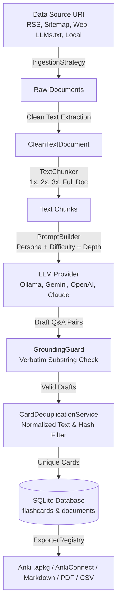

# 🤝 Contributing to Flashcard Master

Thank you for your interest in contributing to **Flashcard Master**! 

Flashcard Master is a local-first, modular TypeScript monorepo designed to convert learning materials (RSS/Atom feeds, Web articles, XML Sitemaps, LLMs.txt catalogs, and local Markdown files) into factual, hallucination-free active-recall flashcards with zero telemetry.

This guide explains how the system is structured, how to set up your local development environment, and how to extend the codebase.

---

## 🏗️ Architecture & Monorepo Structure

Flashcard Master follows **Clean Hexagonal Architecture (Ports & Adapters)**. Domain rules and business logic are strictly isolated from third-party vendor SDKs, databases, and UI frameworks.

```
flashcard-master/
├── packages/
│   ├── core/           # 🧠 Domain models, repositories, ports & business services
│   │   ├── src/domain/     # Pure TypeScript models & Zod schemas
│   │   ├── src/ports/      # Interface contracts (LLMProvider, IngestionStrategy, Exporter)
│   │   ├── src/services/   # Generation, chunking, deduplication, grounding guard
│   │   └── src/storage/    # SQLite database client, migrations & repositories
│   │
│   ├── adapters/       # 🔌 Concrete external technology implementations
│   │   ├── src/ingestion/  # RSS, Web Reader, Local File, Sitemap, LLMs.txt
│   │   ├── src/llm/        # Ollama, Gemini, OpenAI, Claude adapters
│   │   └── src/export/     # Anki (.apkg), AnkiConnect HTTP, CSV, TSV, Markdown, PDF/HTML
│   │
│   ├── cli/            # 💻 Terminal interface & interactive wizards
│   │   ├── src/app.ts      # Application context & dependency injection container
│   │   └── src/cli.ts      # Commander.js CLI commands (init, source, sync, generate, export, serve)
│   │
│   └── web/            # 🌐 Local Single-Page Application (SPA) & REST backend
│       ├── src/server.ts   # Node.js HTTP REST API server
│       └── client/         # Svelte 5 + Vite reactive frontend dashboard
│           └── src/views/  # Dashboard, Sources, Generate Studio, Question Explorer, Export Center
│
├── _bmad-output/       # 📋 BMad Agile Planning & Implementation Artifacts
│   ├── planning-artifacts/   # PRD, Epics, Architecture specs
│   └── implementation-artifacts/ # Sprint status, story specs, retrospectives
└── docs/               # 📖 Technical documentation & architectural deep-dives
```

---

## ⚡ Quick Start: Local Development Setup

### 1. Prerequisites
* **Node.js:** `v20.x` or `v22.x` (ESM native modules)
* **npm:** `v10+` (workspaces enabled)
* **SQLite:** Handled automatically via native `better-sqlite3` bindings

### 2. Setup Repository
```bash
# Clone the repository
git clone https://github.com/alexprodan99/flashcard-master.git
cd flashcard-master

# Install all monorepo workspace dependencies
npm install

# Build all TypeScript packages and Svelte client
npm run build

# Run the complete test suite
npm test
```

### 3. Launch Development Server
```bash
# Starts the local Web UI server on http://localhost:3000
npm start

# Or run the CLI directly
node packages/cli/dist/bin.js --help
```

---

## 🔄 Core Data Flow: How the System Works



---

## 🧩 How to Extend Flashcard Master

### 1. Adding a New Ingestion Strategy
To ingest learning materials from a new source type (e.g. YouTube transcripts, Notion export, EPUB):

1. **Define the Source Type:**
   Add the type identifier in [`packages/core/src/domain/models.ts`](file:///C:/Users/aprodan/Workspace/Projects/flashcard-master/packages/core/src/domain/models.ts) (`DataSourceTypeSchema`).
2. **Implement `IngestionStrategyPort`:**
   Create a class in `packages/adapters/src/ingestion/your-strategy.ts`:
   ```typescript
   import type { IngestionStrategyPort, RawDocument, CleanTextDocument, DataSource } from "@flashcard-master/core";

   export class YourIngestionStrategy implements IngestionStrategyPort {
     readonly type = "your-type";

     async fetch(source: DataSource): Promise<RawDocument[]> {
       // Fetch raw content
     }

     extractCleanText(raw: RawDocument): CleanTextDocument {
       // Strip boilerplate and return clean markdown/text
     }
   }
   ```
3. **Register in Container:**
   Register the strategy in [`packages/cli/src/app.ts`](file:///C:/Users/aprodan/Workspace/Projects/flashcard-master/packages/cli/src/app.ts) inside `createAppContext()`.

---

### 2. Adding a New LLM Provider Adapter
To add support for a new AI provider (e.g. Mistral, DeepSeek, LocalAI):

1. **Implement `LLMProviderPort`:**
   Create an adapter in `packages/adapters/src/llm/your-adapter.ts` implementing `generateQAPairs(text, options)`.
2. **Export and Register:**
   Add factory branch in [`packages/adapters/src/llm/index.ts`](file:///C:/Users/aprodan/Workspace/Projects/flashcard-master/packages/adapters/src/llm/index.ts).

---

### 3. Adding a New Exporter Format
To export flashcards to a new format (e.g. RemNote, Logseq, Quizlet):

1. **Implement `ExporterPort`:**
   Create a class in `packages/adapters/src/export/your-exporter.ts` with `readonly format = "your-format"`.
2. **Register in Container:**
   Register the instance in `ExporterRegistry` in `packages/cli/src/app.ts`.

---

## 🧪 Testing Guidelines

We use **Vitest** for blazing fast, parallel testing across all packages:

```bash
# Run all tests once across the monorepo
npm test

# Run tests in watch mode
npm run test:watch

# Run tests for a specific workspace package
npm test -w @flashcard-master/core
npm test -w @flashcard-master/adapters
npm test -w @flashcard-master/web
```

### Invariants Every Test Must Uphold:
1. **No External Network Calls in Unit Tests:** Mock HTTP requests and LLM endpoints.
2. **Deterministic SQLite State:** Use in-memory SQLite instances (`createDatabaseClient({ inMemory: true })`) in `beforeEach` hooks.
3. **100% Quote Grounding Validation:** Ensure all generated cards include verbatim source quotes.

---

## 📜 Coding Conventions & Best Practices

* **TypeScript Strict Mode:** All code must compile cleanly with `tsc --noEmit`. No `any` when a domain type exists.
* **Svelte 5 Runes:** In the Web UI client, use `$state`, `$derived`, and `$props()` (avoid legacy Svelte 3/4 `let` reactivity or `$$props`).
* **Git Branching:**
  * Feature branches: `feat/epic<N>-short-description` or `feat/short-description`.
  * Commit messages: `feat(...)`, `fix(...)`, `test(...)`, `docs(...)`, `refactor(...)`.

---

## 📋 BMad Methodology

Flashcard Master uses the **BMad Agile Development Framework**:
* **Requirements:** Tracked in [`_bmad-output/planning-artifacts/prd/prd.md`](file:///C:/Users/aprodan/Workspace/Projects/flashcard-master/_bmad-output/planning-artifacts/prd/prd.md).
* **Epics:** Defined in [`_bmad-output/planning-artifacts/epics.md`](file:///C:/Users/aprodan/Workspace/Projects/flashcard-master/_bmad-output/planning-artifacts/epics.md).
* **Sprint Tracking:** Monitored in [`_bmad-output/implementation-artifacts/sprint-status.yaml`](file:///C:/Users/aprodan/Workspace/Projects/flashcard-master/_bmad-output/implementation-artifacts/sprint-status.yaml).
* **Retrospectives:** Evidence-based retrospectives generated at the end of each epic.
