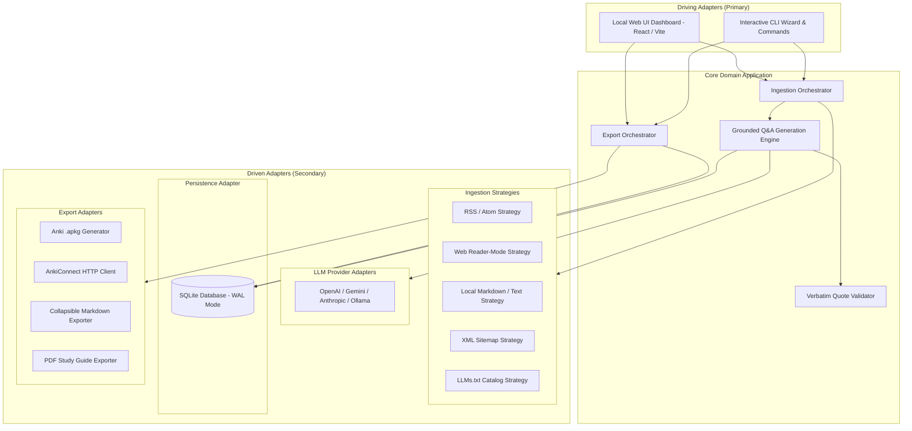

# Technical Architecture Spine: flashcard-master

## 1. Architectural Paradigm & System Overview

`flashcard-master` is built on a **Ports & Adapters (Hexagonal) Architecture** combined with the **Strategy Pattern** for extensible data ingestion and export pipelines.

The core domain contains business logic for Q&A extraction, card validation, and grounding rules. All external dependencies (HTTP fetchers, LLMs, SQLite database, AnkiConnect, and file formatters) are driven through typed port interfaces.



---

## 2. Architectural Invariants (Decision Records AD-1 to AD-8)

### AD-1: Hexagonal Architecture (Ports & Adapters)
- **Binds:** Domain business logic (grounding verification, delta sync logic, card modeling).
- **Prevents:** Direct coupling between UI/CLI frameworks, database engines, or third-party LLM SDKs and core domain logic.
- **Rule:** Core domain modules MUST NOT import any database driver, UI framework, or specific LLM SDK. All interactions MUST proceed through interfaces defined in `core/ports/`.

### AD-2: Strategy Pattern for Pluggable Ingestion
- **Binds:** `IngestionStrategy` interface contract:
  ```typescript
  interface IngestionStrategy {
    readonly type: DataSourceType; // 'rss' | 'web' | 'local'
    fetch(source: DataSource, lastSync?: SyncState): Promise<RawDocument[]>;
    extractCleanText(raw: RawDocument): CleanTextDocument;
  }
  ```
- **Prevents:** Monolithic scraping logic and unmaintainable `switch(type)` branching.
- **Rule:** Every new data source type MUST be implemented as a self-contained strategy class implementing `IngestionStrategy` and registered in `StrategyRegistry`.

### AD-3: Local-First Embedded SQLite Persistence (WAL Mode)
- **Binds:** Single-file local relational storage located at `~/.flashcard-master/data.sqlite` (or workspace local).
- **Prevents:** External database server dependencies, network flakiness, and data privacy leaks.
- **Rule:** SQLite MUST be configured with `PRAGMA journal_mode = WAL` and `PRAGMA foreign_keys = ON`. All multi-card generation transactions MUST execute atomically.

### AD-4: Vendor-Neutral LLM Provider Port
- **Binds:** `LLMProviderPort` abstraction:
  ```typescript
  interface LLMProviderPort {
    generateQAPairs(text: string, options: GenerationOptions): Promise<GeneratedCardDraft[]>;
  }
  ```
- **Prevents:** Vendor lock-in; enables switching between OpenAI, Anthropic, Google Gemini, and local private Ollama models via configuration.
- **Rule:** Prompt templates, difficulty scaling, and persona instructions live in the core domain; adapters only handle API authentication, rate limits, and JSON response normalization.

### AD-5: Verbatim Quote Verification Interceptor
- **Binds:** Mandatory post-generation factual grounding check.
- **Prevents:** AI hallucinations and synthetic quotes from entering the user's flashcard database.
- **Rule:** For every generated card draft, the `GroundingGuard` MUST verify that `draft.sourceQuote` is a substring of the source article text (normalized whitespace). If not found, the card MUST be discarded or regenerated.

### AD-6: Multi-Target Exporter Port Architecture
- **Binds:** `ExporterPort` interface contract:
  ```typescript
  interface ExporterPort {
    readonly format: 'apkg' | 'ankiconnect' | 'csv' | 'tsv' | 'markdown' | 'pdf';
    export(cards: Flashcard[], options: ExportOptions): Promise<ExportResult>;
  }
  ```
- **Prevents:** Hardcoded export logic inside database queries or UI components.
- **Rule:** Each export target MUST be an independent adapter module capable of batch processing flashcard records into target output streams or API payloads.

### AD-7: Monorepo Architecture with TypeScript (Node.js & React)
- **Binds:** Shared TypeScript domain package (`@flashcard-master/core`) imported by both CLI package and Web UI dashboard.
- **Prevents:** Code duplication between terminal commands and web API controllers.
- **Rule:** All types, database repositories, strategies, and ports live in `packages/core`. The CLI (`packages/cli`) and Web UI (`packages/web`) act strictly as driving presentation layers.

### AD-8: Incremental Delta Sync Invariant
- **Binds:** Synchronization state tracking table (`sync_state`).
- **Prevents:** Re-fetching, re-parsing, and duplicate LLM card generation from previously processed posts or unmodified files.
- **Rule:** For RSS sources, check article `guid` / publication date. For local files and web pages, compute SHA-256 hash of extracted text. Skip generation if hash matches `sync_state.content_hash`.

### AD-9: In-Browser Web Generation Studio Controller (`POST /api/generate`)
- **Binds:** `WebServer` driving controller directly to `LLMProviderPort`, `CardGenerationService`, `GroundingGuard`, and `CardDeduplicationService`.
- **Prevents:** Business logic duplication in UI routes and insecure persistence of runtime API keys.
- **Rule:** 
  1. API keys passed via `POST /api/generate` body MUST be used transiently for the lifetime of that request and NEVER written to the database or logged to disk.
  2. The controller supports single source, multiple selected source IDs, or all active sources.
  3. All generated cards undergo mandatory verbatim substring verification via `GroundingGuard` and duplicate filtering via `CardDeduplicationService` before atomic persistence to SQLite.
  4. The response returns structured metrics: `{ success: true, cardsCreated, totalDraftsGenerated, duplicatesSkipped, newCards }`.

### AD-10: Svelte 5 Client Build & Static Asset Delivery Pipeline
- **Binds:** Frontend application architecture in `packages/web/client/` using Svelte 5 runes (`$state`, `$derived`, `$props`) compiled via Vite into static assets in `packages/web/dist/client/`.
- **Prevents:** Fragile imperative string-interpolated HTML templating, Virtual DOM runtime overhead, and cross-view state synchronization bugs.
- **Rule:**
  1. The Web UI client MUST be written in Svelte 5 single-file components with scoped styles and TypeScript.
  2. `npm run build -w @flashcard-master/web` executes both `vite build` (compiling Svelte components) and `tsc` (compiling Node backend server).
  3. The `WebServer` serves compiled static assets (`index.html`, JS chunks, CSS bundles) from `dist/client/` when available, while routing all `/api/*` requests to the REST controllers.
  4. The backend server remains 100% decoupled from the UI framework, relying solely on JSON REST endpoints.

### AD-11: Multi-URL Web Ingestion & Bounded Concurrency
- **Binds:** `WebReaderStrategy` ingestion and `data_sources.uri` contract.
- **Prevents:** Breaking schema migrations for web sources and high-concurrency requests hammering external web servers.
- **Rule:**
  1. `data_sources.uri` for `type = 'web'` accepts either a single URL string (`"https://..."`) or a serialized JSON array string (`'["https://a.com", "https://b.com"]'`).
  2. `WebReaderStrategy.fetch()` parses and normalizes the URI input into an array of URLs.
  3. `WebReaderStrategy` executes page fetching concurrently with a bounded pool (concurrency limit = 3–5) using `Promise.allSettled` to isolate network/parsing failures per URL.
  4. Each fetched URL produces a distinct `RawDocument` / `CleanTextDocument` persisted to the `documents` table with its unique origin URL.

### AD-12: Document Lifecycle & Non-Destructive Flashcard Preservation
- **Binds:** Document deletion contracts across `DocumentRepository`, `CardRepository`, and REST controllers (`DELETE /api/documents/:id`, `POST /api/documents/bulk-delete`).
- **Prevents:** Orphaned, broken, or accidentally deleted flashcards when users clean up noisy or temporary raw document texts.
- **Rule:**
  1. Deleting a document removes the row from the `documents` table.
  2. The `flashcards` table MUST not cascade-delete cards when a document is removed. All cards retain their standalone immutable fields: `question`, `answer`, `source_quote`, `source_origin_url`, `document_title`, `difficulty`, and `target_deck`.
  3. REST controllers return deleted counts and updated document catalogs.

### AD-13: Document Knowledge Base Exporter Architecture (`DocumentExportService`)
- **Binds:** Document export port and formatting pipeline:
  ```typescript
  export type DocumentExportFormat = 'markdown' | 'html' | 'txt' | 'json' | 'epub';
  export type DocumentExportMode = 'merged' | 'split';

  export interface DocumentExportOptions {
    format: DocumentExportFormat;
    mode: DocumentExportMode;
    sourceName?: string;
    includeTableOfContents?: boolean;
    includeCitations?: boolean;
  }

  export interface DocumentExportResult {
    filename: string;
    mimeType: string;
    content: string | Buffer | Uint8Array;
  }
  ```
- **Prevents:** Ad-hoc file generation in web server controllers and tight coupling between UI and export formatters.
- **Rule:**
  1. `DocumentExportService` in `packages/core` coordinates clean text transformation into Markdown, HTML, Plain Text, JSON, and EPUB.
  2. In **Merged Mode**, documents are joined in order with:
     - Header banner (Title, Generation Date, Total Documents, Total Word Count).
     - Clickable Table of Contents with markdown/HTML jump links.
     - Section dividers with document title, word count, and source URL citation link.
  3. In **Split Mode**, individual documents are packaged into a `.zip` archive using `JSZip` with sanitized slug filenames (`01-title.md`, etc.).
  4. WebServer streams the result with `Content-Disposition: attachment; filename="..."` and the correct MIME type.

### AD-14: EPUB 3.0 Document Knowledge Base Exporter
- **Binds:** `DocumentExportService.exportEpub` and EPUB 3.0 container packaging.
- **Prevents:** External heavy runtime eBook dependencies and malformed e-reader files incompatible with Kindle / Apple Books / Kobo / Calibre.
- **Rule:**
  1. EPUBs are packaged using `JSZip` containing uncompressed `mimetype` (`application/epub+zip`), `META-INF/container.xml`, `OEBPS/content.opf` (manifest, metadata, spine), `OEBPS/nav.xhtml`, `OEBPS/toc.ncx`, `OEBPS/styles.css`, and XHTML chapter documents.
  2. Local media assets referenced in document bodies are embedded into `OEBPS/images/` and referenced via relative paths.
  3. Strict XHTML compliance is enforced (closed tags, XML entities).

### AD-15: Mixed Difficulty Schema & Adaptive Prompt Directives
- **Binds:** Domain models (`DifficultyLevelSchema`), database CHECK constraints, and LLM prompt generation pipelines.
- **Prevents:** Inflexible generation presets where users must run separate generation passes for beginner, intermediate, and expert cards.
- **Rule:**
  1. `DifficultyLevelSchema` expands to `z.enum(["beginner", "intermediate", "expert", "mixed"])`.
  2. The SQLite `flashcards` table CHECK constraint expands to `CHECK(difficulty IN ('beginner', 'intermediate', 'expert', 'mixed'))`.
  3. When `difficulty = 'mixed'`, LLM prompt templates instruct the model to produce a balanced progression of beginner, intermediate, and expert cards, assigning the specific difficulty to each synthesized card.
  4. The Question Explorer and card editor provide filter chips and badge renderers for `mixed`.

### AD-16: Reactive Question Explorer Dynamic Cache Refresh
- **Binds:** `QuestionExplorer.svelte` client state and `fetchCards` API invocation.
- **Prevents:** Stale client card catalogs requiring browser page reload or navigation churn after synthesis/edits.
- **Rule:**
  1. A dedicated "🔄 Refresh" action is provided in the toolbar with reactive loading runes (`$state(loading)`).
  2. The refresh operation preserves the user's active filter state (`selectedDeck`, `selectedDifficulty`, `searchQuery`).
  3. In-flight refresh requests disable the button and show an animated spinner to prevent race conditions.

### AD-17: Local Data Source File Picker & Upload Handler
- **Binds:** `AddSourceModal.svelte`, `EditSourceModal.svelte`, and WebServer upload route `POST /api/sources/upload`.
- **Prevents:** User errors from manually typing absolute filesystem paths in the web browser.
- **Rule:**
  1. When source type is `'local'`, the UI presents an interactive file dropzone and file chooser (`<input type="file" accept=".md,.markdown,.txt" />`).
  2. Uploaded files are written to `.flashcard-master/local-files/` (or `data/uploads/`) and assigned absolute paths.
  3. The source name is auto-derived from the file basename if not already provided.
  4. Advanced users retain the option to input directory paths or absolute filesystem paths via a toggle.

---

## 3. Database Schema Specification (SQLite)

```sql
-- Data Sources Registry
CREATE TABLE IF NOT EXISTS data_sources (
    id TEXT PRIMARY KEY,
    name TEXT NOT NULL,
    type TEXT NOT NULL CHECK(type IN ('rss', 'web', 'local', 'sitemap', 'llms-txt')),
    uri TEXT NOT NULL,
    target_deck TEXT NOT NULL DEFAULT 'Default',
    tags TEXT NOT NULL DEFAULT '[]', -- JSON array of strings
    is_active INTEGER NOT NULL DEFAULT 1,
    created_at TEXT NOT NULL DEFAULT (datetime('now')),
    updated_at TEXT NOT NULL DEFAULT (datetime('now'))
);

-- Discovered Documents Catalog per Data Source
CREATE TABLE IF NOT EXISTS documents (
    id TEXT PRIMARY KEY,
    source_id TEXT NOT NULL REFERENCES data_sources(id) ON DELETE CASCADE,
    title TEXT NOT NULL,
    url TEXT,
    text_content TEXT NOT NULL,
    content_hash TEXT NOT NULL,
    word_count INTEGER NOT NULL DEFAULT 0,
    created_at TEXT NOT NULL DEFAULT (datetime('now')),
    updated_at TEXT NOT NULL DEFAULT (datetime('now')),
    UNIQUE(source_id, url)
);

-- Synchronization Cursor & Hash Cache
CREATE TABLE IF NOT EXISTS sync_state (
    source_id TEXT PRIMARY KEY REFERENCES data_sources(id) ON DELETE CASCADE,
    last_synced_at TEXT NOT NULL,
    last_guid TEXT,
    content_hash TEXT,
    item_count INTEGER NOT NULL DEFAULT 0
);

-- Generated Flashcards Store (Self-Contained & Resilient)
CREATE TABLE IF NOT EXISTS flashcards (
    id TEXT PRIMARY KEY,
    source_id TEXT REFERENCES data_sources(id) ON DELETE SET NULL,
    question TEXT NOT NULL,
    answer TEXT NOT NULL,
    source_quote TEXT NOT NULL,
    source_origin_url TEXT,
    document_title TEXT,
    difficulty TEXT NOT NULL CHECK(difficulty IN ('beginner', 'intermediate', 'expert', 'mixed')),
    persona_used TEXT NOT NULL,
    target_deck TEXT NOT NULL,
    tags TEXT NOT NULL DEFAULT '[]',
    created_at TEXT NOT NULL DEFAULT (datetime('now')),
    updated_at TEXT NOT NULL DEFAULT (datetime('now'))
);

-- Application Settings & LLM Config
CREATE TABLE IF NOT EXISTS app_settings (
    key TEXT PRIMARY KEY,
    value TEXT NOT NULL,
    updated_at TEXT NOT NULL DEFAULT (datetime('now'))
);

-- Indices for rapid lookup
CREATE INDEX IF NOT EXISTS idx_flashcards_source_id ON flashcards(source_id);
CREATE INDEX IF NOT EXISTS idx_flashcards_target_deck ON flashcards(target_deck);
CREATE INDEX IF NOT EXISTS idx_flashcards_difficulty ON flashcards(difficulty);
CREATE INDEX IF NOT EXISTS idx_documents_source_id ON documents(source_id);
```

---

## 4. Codebase Directory Structure (Target Scaffold)

```text
flashcard-master/
├── packages/
│   ├── core/                          # Core domain, ports, and models
│   │   ├── src/
│   │   │   ├── domain/                # Flashcard, DataSource, Document, SyncState models
│   │   │   ├── ports/                 # IngestionStrategy, LLMProviderPort, ExporterPort
│   │   │   ├── services/              # IngestionService, QAEngine, GroundingGuard, DocumentExportService
│   │   │   └── storage/               # SQLite repositories & migrations
│   │   └── package.json
│   ├── adapters/                      # Pluggable driven implementations
│   │   ├── ingestion/                 # RssStrategy, WebReaderStrategy, LocalFileStrategy, SitemapStrategy, LlmsTxtStrategy
│   │   ├── llm/                       # OpenAIAdapter, GeminiAdapter, AnthropicAdapter, OllamaAdapter
│   │   └── exporters/                 # ApkgExporter, AnkiConnectAdapter, MarkdownExporter, PdfExporter, DocumentExporters
│   ├── cli/                           # Driving adapter: Terminal CLI & wizard
│   │   ├── src/
│   │   │   ├── commands/              # source, sync, export, cards, config
│   │   │   └── wizard/                # Inquirer / Clack interactive wizard
│   │   └── package.json
│   └── web/                           # Driving adapter: Local Web UI & Node WebServer
│       ├── client/                    # Svelte 5 Single-File Components + Vite
│       │   ├── src/                   # App.svelte, components, views (Dashboard, Sources, Generate, Cards, Export & Anki)
│       │   └── vite.config.ts
│       ├── src/                       # Node.js WebServer (REST API + static asset delivery)
│       └── package.json
└── package.json                       # Turborepo / npm workspaces root
```

---

## 5. Deferred Architectural Decisions

1. **Vector Embedding Storage:** Deferring local vector database (e.g. `sqlite-vec` or `chromadb`) to v2 for semantic similarity deduplication.
2. **Audio / Video Transcription Pipeline:** Deferring Whisper / FFmpeg bindings to v2 (focusing on text-only stability in v1).
3. **Cloud Multi-Device Sync:** Deferring P2P / encrypted CRDT synchronization to future iterations.
