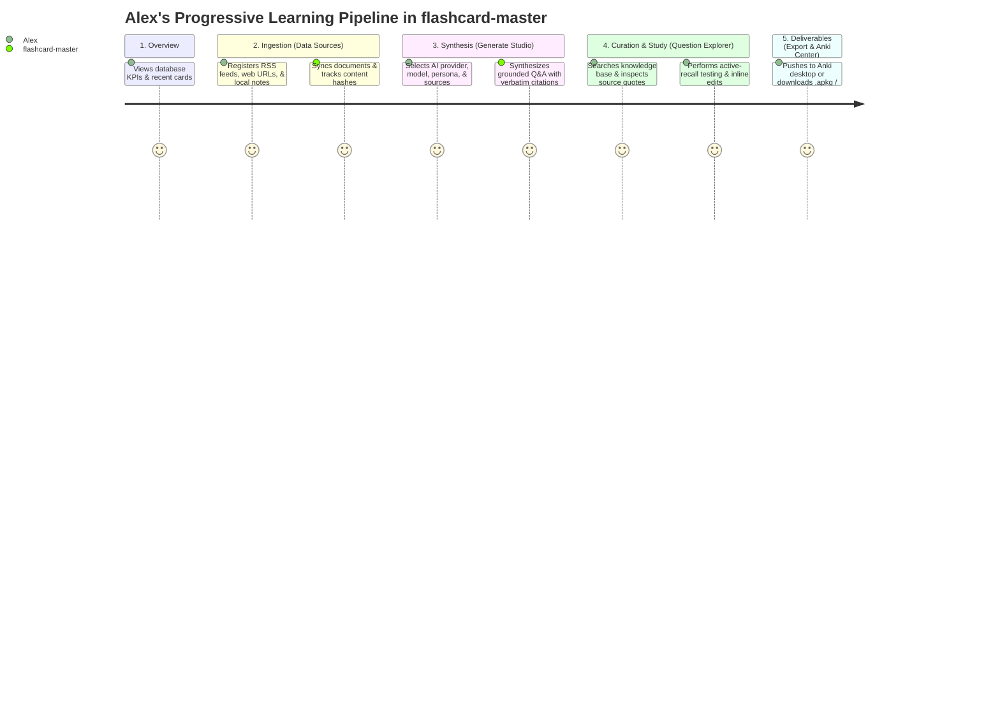

# Product Requirements Document (PRD): flashcard-master

## 1. Product Overview & Strategic Vision

`flashcard-master` is a local-first, AI-powered knowledge extraction and spaced-repetition acceleration tool. It bridges the gap between passive consumption (reading blogs, newsletters, and documentation) and active retention by automatically transforming dynamic text streams into high-yield, atomic flashcards.

Every generated flashcard is strictly tethered to the source text via mandatory **verbatim quote citations**, completely eliminating AI hallucination and enabling rapid verification. Cards are persisted to an embedded local database and exported seamlessly to Anki (`.apkg`, AnkiConnect), active-recall Markdown, and PDF study guides.

### Success Metrics & Target SLAs
- **Onboarding & Source Setup Velocity:** A user can configure a new data source via the interactive CLI wizard or Web UI in **< 60 seconds**.
- **Zero-Touch Card Quality:** The LLM engine produces **10 high-quality, atomic cards with exact verbatim citations in 1 click**, with a target of $\ge 90\%$ card acceptance without manual edits.
- **Export Latency:** AnkiConnect push or `.apkg` generation completes in **< 2 seconds** for batches up to 500 cards.

---

## 2. User Personas & Core User Journeys

### Primary Protagonist: Alex (Senior Software Engineer)
Alex reads technical blogs (Netflix TechBlog, ByteByteGo, HackerNews), engineering RFCs, and framework documentation. Alex wants to retain core system design trade-offs without spending hours manually typing cards into Anki.

### Core User Journeys (UJ)

#### UJ-1: Zero-Friction Setup via Interactive Wizard & Dashboard
1. Alex launches Flashcard Master and views the Dashboard overview displaying database statistics, deck breakdowns, and recent cards.

#### UJ-2: Data Sources Ingestion & Content Tracking
1. Alex navigates to **🌐 Data Sources** (the second menu stage) to register subscribed RSS feeds, web article URLs, or local Markdown directories.
2. Alex clicks "Sync" to ingest clean, reader-mode documents into local storage while tracking delta hashes to prevent duplication.

#### UJ-3: In-Browser AI Card Generation Studio
1. Alex navigates to **⚡ Generate Studio** (the third menu stage) to synthesize flashcards from the ingested materials.
2. Alex selects the AI Provider (Ollama, Gemini, OpenAI, Anthropic), configures the model (with smart 2026 presets or custom text overrides), chooses a cognitive persona (`socratic-mentor`, `strict-examiner`, `analogy-builder`), and checks the target data sources.
3. Alex clicks "Start AI Generation", watching real-time spinner feedback as cards are synthesized, verified against verbatim grounding citations, and deduplicated into SQLite.

#### UJ-4: Visual Exploration, Search & Active-Recall Practice
1. Alex navigates to **🗂️ Question Explorer** (the fourth menu stage) to browse the generated knowledge base.
2. Alex searches by keyword, filters with interactive deck/tag/difficulty chips, tests knowledge using click-to-reveal answer cards, and performs inline edits via the slide-over drawer.

#### UJ-5: Multi-Target Export & Spaced Repetition Study
1. Alex navigates to **🚀 Export & Anki** (the final menu stage) to deliver flashcards to external study environments.
2. Alex 1-clicks "Push to Anki Desktop" via live AnkiConnect, or downloads `.apkg`, active-recall Markdown (`
` blocks), CSV, or printable two-column HTML study sheets.

---

## 3. Functional Requirements (FRs)

### 3.1 Data Ingestion & Strategy Engine

| Requirement ID | Title | Description | Priority |
| :--- | :--- | :--- | :--- |
| **FR-101** | **Ingestion Strategy Interface** | The system MUST implement a modular Strategy Pattern (`IngestionStrategy`) decoupling source fetching from card generation. | Critical |
| **FR-102** | **RSS/Atom Feed Strategy** | The system MUST parse RSS and Atom XML feeds, extract post content, publication dates, and unique GUIDs. | High |
| **FR-103** | **Web Article Strategy** | The system MUST fetch arbitrary HTTP/HTTPS web URLs and extract clean article text in reader mode (stripping boilerplate, navigation, ads). | High |
| **FR-104** | **Local Document Strategy** | The system MUST ingest local files and directories (supporting `.md`, `.txt`, `.markdown`) matching configurable glob patterns. | High |
| **FR-105** | **Incremental Delta Sync** | The system MUST track processed article GUIDs and file SHA-256 hashes in `sync_state` table to prevent re-processing identical content. | High |
| **FR-106** | **Database Source Registry** | The system MUST store data sources in a local SQLite database with editable metadata (name, type, URI, target deck, default tags, sync status). | Critical |
| **FR-107** | **XML Sitemap Ingestion Strategy** | The system MUST support XML sitemaps (both `<urlset>` and `<sitemapindex>`), discover nested URLs with optional path/glob filtering, and ingest clean reader-mode text in parallel. | High |
| **FR-108** | **LLMs.txt / Markdown Catalog Strategy** | The system MUST parse machine-readable `/llms.txt` and `/llms-full.txt` catalogs, extracting canonical URLs, topic categories, and summaries. | High |

### 3.2 Grounded Q&A Generation Engine

| Requirement ID | Title | Description | Priority |
| :--- | :--- | :--- | :--- |
| **FR-201** | **Atomic Front/Back Cards** | The engine MUST generate concise, atomic Front/Back Q&A flashcards following the Minimum Information Principle (1 concept per card). | Critical |
| **FR-202** | **Verbatim Citation Guard** | Every generated card MUST include the exact source sentence/quote it was derived from. Cards lacking verifiable source quotes MUST be rejected. | Critical |
| **FR-203** | **Configurable Difficulty** | The system MUST support configurable difficulty levels (`beginner`, `intermediate`, `expert`) modifying the cognitive depth of generated questions. | Medium |
| **FR-204** | **Selectable Prompt Personas** | The system MUST support selectable generation personas (`socratic-mentor`, `strict-examiner`, `executive-synthesizer`) and allow custom persona prompts. | Medium |
| **FR-205** | **Auto-Commit to Database** | Generated flashcards MUST be automatically committed directly to the database with source foreign key, difficulty, tags, and timestamps. | Critical |
| **FR-206** | **Question Deduplication** | `[ASSUMPTION]` The system SHOULD calculate text similarity or concept overlap to filter out duplicate questions generated from adjacent sources. | Low |

### 3.3 Multi-Target Exporter Pipeline

| Requirement ID | Title | Description | Priority |
| :--- | :--- | :--- | :--- |
| **FR-301** | **Native Anki Package (.apkg)** | The system MUST generate valid `.apkg` files containing front/back card templates, custom CSS styling, tags, and source metadata fields. | Critical |
| **FR-302** | **AnkiConnect Live Sync** | The system MUST support pushing cards directly into desktop Anki via the AnkiConnect HTTP API (`http://localhost:8765`). | High |
| **FR-303** | **Delimited File Export** | The system MUST export flashcards to standard Anki-compatible CSV and TSV formats. | Medium |
| **FR-304** | **Active-Recall Markdown** | The system MUST export cards as Markdown files utilizing collapsible HTML `

Question
Answer & Quote
` tags. | High |
| **FR-305** | **PDF Study Guide** | The system MUST export cards into a structured, printable 2-column Q&A PDF study sheet with citation callouts. | Medium |
| **FR-306** | **Scoped Export Filtering** | The system MUST allow filtering exports by specific data source, tag, difficulty level, or creation date range. | High |

### 3.4 Dual User Interface (CLI & Web UI)

| Requirement ID | Title | Description | Priority |
| :--- | :--- | :--- | :--- |
| **FR-401** | **Interactive CLI Setup Wizard** | The CLI MUST provide an interactive terminal wizard (`flashcard-master config init` / `source add -i`) with keyboard navigation. | High |
| **FR-402** | **Scriptable CLI Subcommands** | The CLI MUST provide non-interactive subcommands (`source`, `sync`, `export`, `cards`, `config`) for headless scripting. | High |
| **FR-403** | **Progressive 4-Step Web UI Pipeline** | The system MUST serve a lightweight local web dashboard (`flashcard-master serve` on `localhost:3000`) structured with a Central Dashboard Overview 📊 and a chronological 4-Step Learning Pipeline: **1. Ingest Sources 🌐 $\rightarrow$ 2. Generate Studio ⚡ $\rightarrow$ 3. Question Explorer 🗂️ $\rightarrow$ 4. Export & Anki 🚀**. | High |
| **FR-404** | **UI Sources Management** | The Web UI MUST allow users to add, edit, toggle, and trigger manual sync on data sources with live progress feedback. | High |
| **FR-405** | **UI Question Explorer & Editor** | The Web UI MUST provide a searchable card database with keyword search, filter chips, and inline card editing. | High |
| **FR-406** | **UI 1-Click Export & Anki Center** | The Web UI MUST offer 1-click downloads for `.apkg`, Markdown, PDF, and 1-click Push to running AnkiConnect. | High |
| **FR-407** | **UI AI Generation Studio** | The Web UI MUST provide an in-browser generation studio with provider switching (Ollama, Gemini, OpenAI, Anthropic), smart model defaults, and custom model text overrides. | Critical |
| **FR-408** | **UI Multi-Source Scope Selector** | The Web UI MUST provide an interactive multi-source checkbox list with type badges, master "Toggle All" control, and real-time selection counter to selectively synthesize cards from any subset of sources. | High |
| **FR-409** | **UI Secure API Key Input** | The Web UI MUST allow optional in-browser API key entry for cloud LLM providers with automatic fallback to server environment variables. | Medium |
| **FR-410** | **UI Live Generation Feedback** | The Web UI MUST display real-time spinning state during generation, followed by metric reporting (cards created, duplicates skipped, ungrounded rejected) and card previews. | High |
| **FR-411** | **Svelte 5 Reactive Client Architecture** | The Web UI MUST be architected with Svelte 5 single-file components and reactive runes ($state, $derived), compiled via Vite into static client assets served locally by the Node.js backend server with zero Virtual DOM overhead. | High |
| **FR-412** | **UI & CLI Sitemap Source Configuration** | The Web UI (Add Source Modal, Sources View) and CLI (`source add`) MUST support registering and syncing `sitemap` and `llms-txt` source types with optional URL path filtering and batch progress feedback. | High |
| **FR-205** | **Emphatic Verbatim Prompt Directives** | The system prompt MUST include strict, unambiguous copy-paste directives instructing the LLM to extract exact verbatim substring quotes without paraphrasing or alteration to maximize grounding accuracy on local models. | High |
| **FR-206** | **Adaptive Generation Backfill Loop** | The card generation service MUST employ adaptive oversampling and retry backfilling to ensure the user-specified target count of valid flashcards is achieved per chunk even when ungrounded drafts are discarded. | High |
| **FR-207** | **Document Provenance & Material Reference** | Generated flashcards MUST retain rich material references (Document Title, Origin URL, Section / Topic Tag) presented in the Explorer, Editor Drawer, and exported files. | Medium |
| **FR-306** | **Printable PDF Export Support** | The export engine MUST support `pdf` format requests by routing to print-optimized HTML study sheets with `@media print` CSS for physical paper flashcards and browser "Save as PDF". | High |
| **FR-413** | **Question Explorer Bulk Deletion** | The Question Explorer MUST provide multi-card selection checkboxes, a "Select All" toggle, a selected item counter badge, and bulk-delete API support (`DELETE /api/cards/bulk`) with user confirmation. | High |

---

## 4. Non-Functional Requirements (NFRs)

### 4.1 Performance & Latency
- **NFR-101:** Reader-mode text extraction from standard web articles (< 3,000 words) MUST complete in **< 3 seconds**.
- **NFR-102:** Local database queries (searching across 10,000+ flashcards) MUST return results in **< 100 milliseconds**.

### 4.2 Privacy & Local-First Invariants
- **NFR-201:** All configurations, source URLs, content caches, and generated cards MUST reside exclusively on the user's local disk in SQLite.
- **NFR-202:** No telemetry, tracking, or user content MUST ever be transmitted to external servers (except direct user-configured LLM API calls).

### 4.3 Reliability & Resilience
- **NFR-301:** Ingestion network failures (e.g. timeout on an RSS feed) MUST fail gracefully per-source without crashing the overall sync batch.
- **NFR-302:** Database writes MUST be transactional to prevent orphaned or partially generated card records.

### 4.4 Portability & Cross-Platform Support
- **NFR-401:** The application (CLI and local Web UI) MUST operate consistently across Windows, macOS, and Linux environments.

---

## 5. Explicit Non-Goals & Scope Boundaries (v1)

1. **No Custom Spaced Repetition Scheduler:** `flashcard-master` does not implement its own review repetition algorithm; it delegates scheduling to Anki (SM-2/FSRS).
2. **No Multimodal Data Ingestion:** Audio, video, and image OCR ingestion are excluded from v1 (text-only focus).
3. **No Complex Card Types in v1:** Cloze deletions and Multiple-Choice cards are deferred to future roadmap releases.
4. **No Multi-Tenant Cloud SaaS:** The architecture is strictly single-user, local-first.

---

## 6. Risk Assessment & Mitigations

| Risk | Impact | Likelihood | Mitigation Strategy |
| :--- | :--- | :--- | :--- |
| **LLM Hallucinations in Q&A** | High | Low | **Mandatory Quote Grounding (FR-202):** Prompts require exact verbatim sentence extraction; validator rejects ungrounded answers. |
| **Feed / Web Scraping Breakages** | Medium | Medium | **Modular Ingestion Strategy:** Robust fallback parsers (Readability algorithm) and clear error reporting per source. |
| **AnkiConnect Inavailability** | Low | Medium | **Graceful Fallback:** If Anki desktop is not running, UI/CLI clearly alerts user and provides immediate `.apkg` file download instead. |
| **Duplicate Card Proliferation** | Medium | Medium | **Incremental Delta Sync (FR-105):** GUID and content hash checks prevent re-ingesting unmodified posts. |

