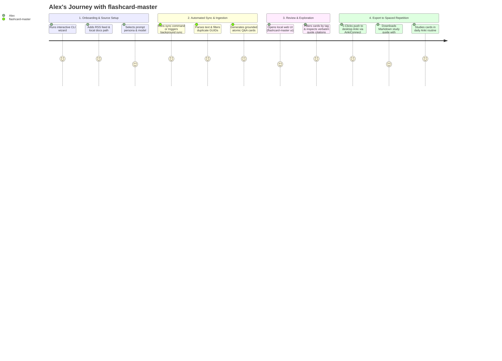

# Product Requirements Document (PRD): flashcard-master

## 1. Product Overview & Strategic Vision

`flashcard-master` is a local-first, AI-powered knowledge extraction and spaced-repetition acceleration tool. It bridges the gap between passive consumption (reading blogs, newsletters, and documentation) and active retention by automatically transforming dynamic text streams into high-yield, atomic flashcards.

Every generated flashcard is strictly tethered to the source text via mandatory **verbatim quote citations**, completely eliminating AI hallucination and enabling rapid verification. Cards are persisted to an embedded local database and exported seamlessly to Anki (`.apkg`, AnkiConnect), active-recall Markdown, and PDF study guides.

### Success Metrics & Target SLAs
- **Onboarding & Source Setup Velocity:** A user can configure a new data source via the interactive CLI wizard or Web UI in **< 60 seconds**.
- **Zero-Touch Card Quality:** The LLM engine produces **10 high-quality, atomic cards with exact verbatim citations in 1 click**, with a target of $\ge 90\%$ card acceptance without manual edits.
- **Export Latency:** AnkiConnect push or `.apkg` generation completes in **< 2 seconds** for batches up to 500 cards.

---

## 2. User Personas & Core User Journeys

### Primary Protagonist: Alex (Senior Software Engineer)
Alex reads technical blogs (Netflix TechBlog, ByteByteGo, HackerNews), engineering RFCs, and framework documentation. Alex wants to retain core system design trade-offs without spending hours manually typing cards into Anki.

### Core User Journeys (UJ)

#### UJ-1: Zero-Friction Setup via Interactive CLI Wizard
1. Alex runs `flashcard-master config init`.
2. The interactive terminal prompt guides Alex through selecting an LLM provider (e.g. OpenAI, Anthropic, Gemini, or local Ollama), configuring API keys, and picking a default generation persona.
3. The wizard prompts to add initial data sources (e.g. an RSS feed URL or `./docs/**/*.md` path) with default target deck names.
4. Configuration is validated and saved to the local SQLite database.

#### UJ-2: Automated Ingestion, Delta Sync & Verbatim Q&A Generation
1. Alex executes `flashcard-master sync` (or triggers sync via the Web UI).
2. The ingestion engine fetches only new articles from subscribed feeds by checking GUID and SHA-256 content hashes.
3. The generation engine analyzes the extracted text, enforces the Minimum Information Principle, attaches verbatim quote citations, and auto-commits the cards to the database.

#### UJ-3: Visual Exploration, Search & Inline Curation (Web UI)
1. Alex runs `flashcard-master ui` and opens `http://localhost:3000`.
2. Alex browses the Question Explorer, searches by keyword or source, views the front/back card anatomy, and verifies the highlighted source quote.
3. Alex can optionally edit or tag cards before export.

#### UJ-4: Multi-Target Export & Spaced Repetition Study
1. Alex selects a target deck or tags and clicks "Sync to Anki".
2. `flashcard-master` transmits cards directly to the running desktop Anki application via AnkiConnect HTTP API.
3. Alternatively, Alex exports a styled `.apkg` file, an active-recall Markdown document (`
` blocks), or a PDF study sheet.

---

## 3. Functional Requirements (FRs)

### 3.1 Data Ingestion & Strategy Engine

| Requirement ID | Title | Description | Priority |
| :--- | :--- | :--- | :--- |
| **FR-101** | **Ingestion Strategy Interface** | The system MUST implement a modular Strategy Pattern (`IngestionStrategy`) decoupling source fetching from card generation. | Critical |
| **FR-102** | **RSS/Atom Feed Strategy** | The system MUST parse RSS and Atom XML feeds, extract post content, publication dates, and unique GUIDs. | High |
| **FR-103** | **Web Article Strategy** | The system MUST fetch arbitrary HTTP/HTTPS web URLs and extract clean article text in reader mode (stripping boilerplate, navigation, ads). | High |
| **FR-104** | **Local Document Strategy** | The system MUST ingest local files and directories (supporting `.md`, `.txt`, `.markdown`) matching configurable glob patterns. | High |
| **FR-105** | **Incremental Delta Sync** | The system MUST track processed article GUIDs and file SHA-256 hashes in `sync_state` table to prevent re-processing identical content. | High |
| **FR-106** | **Database Source Registry** | The system MUST store data sources in a local SQLite database with editable metadata (name, type, URI, target deck, default tags, sync status). | Critical |

### 3.2 Grounded Q&A Generation Engine

| Requirement ID | Title | Description | Priority |
| :--- | :--- | :--- | :--- |
| **FR-201** | **Atomic Front/Back Cards** | The engine MUST generate concise, atomic Front/Back Q&A flashcards following the Minimum Information Principle (1 concept per card). | Critical |
| **FR-202** | **Verbatim Citation Guard** | Every generated card MUST include the exact source sentence/quote it was derived from. Cards lacking verifiable source quotes MUST be rejected. | Critical |
| **FR-203** | **Configurable Difficulty** | The system MUST support configurable difficulty levels (`beginner`, `intermediate`, `expert`) modifying the cognitive depth of generated questions. | Medium |
| **FR-204** | **Selectable Prompt Personas** | The system MUST support selectable generation personas (`socratic-mentor`, `strict-examiner`, `executive-synthesizer`) and allow custom persona prompts. | Medium |
| **FR-205** | **Auto-Commit to Database** | Generated flashcards MUST be automatically committed directly to the database with source foreign key, difficulty, tags, and timestamps. | Critical |
| **FR-206** | **Question Deduplication** | `[ASSUMPTION]` The system SHOULD calculate text similarity or concept overlap to filter out duplicate questions generated from adjacent sources. | Low |

### 3.3 Multi-Target Exporter Pipeline

| Requirement ID | Title | Description | Priority |
| :--- | :--- | :--- | :--- |
| **FR-301** | **Native Anki Package (.apkg)** | The system MUST generate valid `.apkg` files containing front/back card templates, custom CSS styling, tags, and source metadata fields. | Critical |
| **FR-302** | **AnkiConnect Live Sync** | The system MUST support pushing cards directly into desktop Anki via the AnkiConnect HTTP API (`http://localhost:8765`). | High |
| **FR-303** | **Delimited File Export** | The system MUST export flashcards to standard Anki-compatible CSV and TSV formats. | Medium |
| **FR-304** | **Active-Recall Markdown** | The system MUST export cards as Markdown files utilizing collapsible HTML `

Question
Answer & Quote
` tags. | High |
| **FR-305** | **PDF Study Guide** | The system MUST export cards into a structured, printable 2-column Q&A PDF study sheet with citation callouts. | Medium |
| **FR-306** | **Scoped Export Filtering** | The system MUST allow filtering exports by specific data source, tag, difficulty level, or creation date range. | High |

### 3.4 Dual User Interface (CLI & Web UI)

| Requirement ID | Title | Description | Priority |
| :--- | :--- | :--- | :--- |
| **FR-401** | **Interactive CLI Setup Wizard** | The CLI MUST provide an interactive terminal wizard (`flashcard-master config init` / `source add -i`) with keyboard navigation. | High |
| **FR-402** | **Scriptable CLI Subcommands** | The CLI MUST provide non-interactive subcommands (`source`, `sync`, `export`, `cards`, `config`) for headless scripting. | High |
| **FR-403** | **Local Web UI Dashboard** | The system MUST serve a lightweight local web dashboard (`flashcard-master ui` on `localhost:3000`). | High |
| **FR-404** | **UI Sources Management** | The Web UI MUST allow users to add, edit, toggle, and trigger manual sync on data sources with live progress feedback. | High |
| **FR-405** | **UI Question Explorer & Editor** | The Web UI MUST provide a searchable card database with keyword search, filter chips, and inline card editing. | High |
| **FR-406** | **UI 1-Click Export Center** | The Web UI MUST offer 1-click downloads for `.apkg`, Markdown, PDF, and 1-click Push to running AnkiConnect. | High |

---

## 4. Non-Functional Requirements (NFRs)

### 4.1 Performance & Latency
- **NFR-101:** Reader-mode text extraction from standard web articles (< 3,000 words) MUST complete in **< 3 seconds**.
- **NFR-102:** Local database queries (searching across 10,000+ flashcards) MUST return results in **< 100 milliseconds**.

### 4.2 Privacy & Local-First Invariants
- **NFR-201:** All configurations, source URLs, content caches, and generated cards MUST reside exclusively on the user's local disk in SQLite.
- **NFR-202:** No telemetry, tracking, or user content MUST ever be transmitted to external servers (except direct user-configured LLM API calls).

### 4.3 Reliability & Resilience
- **NFR-301:** Ingestion network failures (e.g. timeout on an RSS feed) MUST fail gracefully per-source without crashing the overall sync batch.
- **NFR-302:** Database writes MUST be transactional to prevent orphaned or partially generated card records.

### 4.4 Portability & Cross-Platform Support
- **NFR-401:** The application (CLI and local Web UI) MUST operate consistently across Windows, macOS, and Linux environments.

---

## 5. Explicit Non-Goals & Scope Boundaries (v1)

1. **No Custom Spaced Repetition Scheduler:** `flashcard-master` does not implement its own review repetition algorithm; it delegates scheduling to Anki (SM-2/FSRS).
2. **No Multimodal Data Ingestion:** Audio, video, and image OCR ingestion are excluded from v1 (text-only focus).
3. **No Complex Card Types in v1:** Cloze deletions and Multiple-Choice cards are deferred to future roadmap releases.
4. **No Multi-Tenant Cloud SaaS:** The architecture is strictly single-user, local-first.

---

## 6. Risk Assessment & Mitigations

| Risk | Impact | Likelihood | Mitigation Strategy |
| :--- | :--- | :--- | :--- |
| **LLM Hallucinations in Q&A** | High | Low | **Mandatory Quote Grounding (FR-202):** Prompts require exact verbatim sentence extraction; validator rejects ungrounded answers. |
| **Feed / Web Scraping Breakages** | Medium | Medium | **Modular Ingestion Strategy:** Robust fallback parsers (Readability algorithm) and clear error reporting per source. |
| **AnkiConnect Inavailability** | Low | Medium | **Graceful Fallback:** If Anki desktop is not running, UI/CLI clearly alerts user and provides immediate `.apkg` file download instead. |
| **Duplicate Card Proliferation** | Medium | Medium | **Incremental Delta Sync (FR-105):** GUID and content hash checks prevent re-ingesting unmodified posts. |

