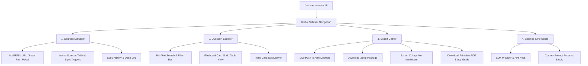
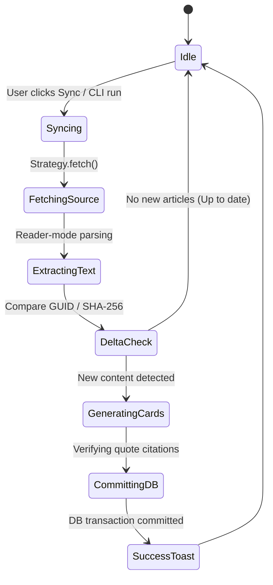

# User Experience & Information Architecture (EXPERIENCE.md)

## 1. Foundation & Information Architecture

`flashcard-master` operates on two unified surfaces:
1. **Interactive CLI Wizard & Terminal Commands:** High-velocity developer workflow.
2. **Local Web UI Dashboard (`flashcard-master ui`):** Rich visual curation, search, and 1-click export.

### Web Dashboard Information Architecture (IA)



---

## 2. Voice & Tone (Microcopy Guidelines)

- **Tone:** Technical, precise, reassuring, and direct.
- **Clarity over cleverness:**
  - *Good:* `"Synced 12 new articles. 28 flashcards generated and committed to SQLite."`
  - *Bad:* `"Voila! Your brain just got bigger."`
- **Error Messages:** Always explain the *why* and give actionable next steps:
  - *Example:* `"AnkiConnect unavailable at localhost:8765. Ensure Anki Desktop is running with the AnkiConnect add-on enabled, or download as an .apkg file."`

---

## 3. Behavioral State Patterns

### Ingestion & Sync Lifecycle


### AnkiConnect Integration State
- **Connected (`🟢 Anki Ready`):** Direct 1-click push enabled.
- **Offline / Disconnected (`⚪ Anki Offline`):** Button displays `"Push to Anki (Offline)"` with tooltip explaining how to launch Anki Desktop, while highlighting the `.apkg` fallback button.

---

## 4. Interaction Primitives & Keyboard Shortcuts

| Shortcut Key | Action | Context |
| :--- | :--- | :--- |
| **`/`** or **`Cmd/Ctrl + K`** | Focus global search bar | Anywhere in Web UI |
| **`s`** or **`Cmd/Ctrl + Shift + S`** | Trigger sync on all active sources | Web UI & CLI |
| **`e`** | Open Export Center | Web UI |
| **`j` / `k`** | Next / Previous flashcard | Question Explorer |
| **`Enter`** | Open card edit drawer | Question Explorer |
| **`Esc`** | Close drawer / modal | Anywhere in Web UI |

---

## 5. Terminal CLI Interaction Design

The CLI uses rich terminal styling (colors, spinners, interactive selection menus):

```text
$ flashcard-master config init

┌  flashcard-master Setup Wizard
│
◇  Select your LLM Provider:
│  ● OpenAI (GPT-4o / GPT-4o-mini)
│  ○ Anthropic (Claude 3.5 Sonnet)
│  ○ Google Gemini (Gemini 2.5 Pro/Flash)
│  ○ Ollama (Local & Private)
│
◇  Enter API Key:
│  sk-proj-****************************************
│
◇  Choose Default Generation Persona:
│  ● Socratic Mentor (Principles & Mental Models)
│  ○ Strict Technical Examiner (Syntax, Edge Cases & Trade-offs)
│  ○ Executive Synthesizer (High-level Strategic Summaries)
│
◇  Add your first data source now?
│  ● Yes / ○ No
│
└  Configuration saved to local database (~/.flashcard-master/db.sqlite). Ready to study!
```

---

## 6. Accessibility Floor (WCAG 2.1 AA)

1. **Color Contrast:** All text tokens meet or exceed $4.5:1$ contrast against their respective surface backgrounds.
2. **Keyboard Traps:** All modals and slide-out drawers contain focus traps with visible focus rings (`ring-2 ring-indigo-500`).
3. **Screen Readers:** ARIA labels on icon buttons (e.g. `aria-label="Edit flashcard"`, `aria-live="polite"` on sync progress bars).
