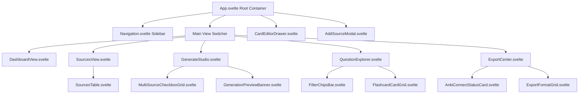
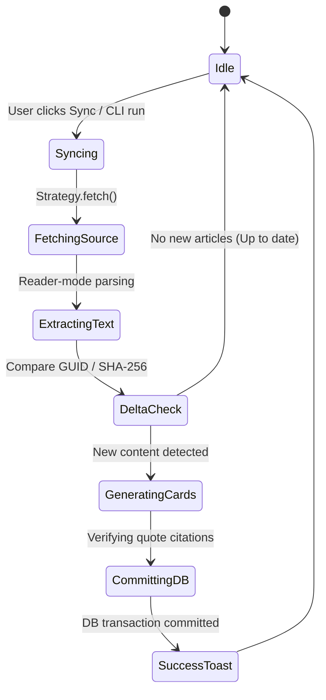

# User Experience & Information Architecture (EXPERIENCE.md)

## 1. Foundation & Information Architecture

`flashcard-master` operates on two unified surfaces:
1. **Interactive CLI Wizard & Terminal Commands:** High-velocity developer workflow.
2. **Local Web UI Dashboard (`flashcard-master ui`):** Rich visual curation, search, and 1-click export.

### Web Dashboard Information Architecture & Svelte Component Hierarchy



---

## 2. Voice & Tone (Microcopy Guidelines)

- **Tone:** Technical, precise, reassuring, and direct.
- **Clarity over cleverness:**
  - *Good:* `"Synced 12 new articles. 28 flashcards generated and committed to SQLite."`
  - *Bad:* `"Voila! Your brain just got bigger."`
- **Error Messages:** Always explain the *why* and give actionable next steps:
  - *Example:* `"AnkiConnect unavailable at localhost:8765. Ensure Anki Desktop is running with the AnkiConnect add-on enabled, or download as an .apkg file."`

---

## 3. Behavioral State Patterns

### Ingestion & Sync Lifecycle


### AnkiConnect Integration State
- **Connected (`🟢 Anki Ready`):** Direct 1-click push enabled.
### 3.3 AI Generation Studio (In-Browser Studio & Model Controls)

```text
┌  ⚡ AI Flashcard Generation Studio ─────────────────────────────────────────┐
│  Extract grounded, atomic flashcards directly from your ingested materials.   │
├──────────────────────────────────────┬───────────────────────────────────────┤
│  ⚙️ Studio Configuration             │  📊 Live Execution & Results          │
│                                      │                                       │
│  1. AI Provider:                     │  Status: [ 🟢 Ready to Generate ]     │
│  [ 🔵 Google Gemini              ▾ ] │                                       │
│                                      │  Summary Metrics:                     │
│  2. Model Identifier:                │  • Cards Created: 0                   │
│  [ gemini-2.0-flash                ] │  • Duplicates Filtered: 0             │
│                                      │  • Ungrounded Rejected: 0             │
│  3. API Key (Optional Override):     │                                       │
│  [ ••••••••••••••••••••••••••••••  ] │  Generated Card Previews:             │
│  (Leave blank to use GEMINI_API_KEY) │  ┌─────────────────────────────────┐ │
│                                      │  │ [System Design] [Intermediate]  │ │
│  4. Learning Persona:                │  │ Q: What is WAL mode in SQLite?  │ │
│  [ 🎓 Socratic Mentor            ▾ ] │  │ A: Write-Ahead Logging for ...  │ │
│                                      │  │ "SQLite uses WAL mode for..."   │ │
│  5. Difficulty:                      │  └─────────────────────────────────┘ │
│  [ 🟡 Intermediate               ▾ ] │                                       │
│                                      │  [ 👁️ View in Question Explorer ]     │
│  6. Ingested Sources Scope:          │                                       │
│  [ 3 / 4 Sources Selected ] [Toggle] │                                       │
│  ┌─────────────────────────────────┐ │                                       │
│  │ [x] Martin Fowler Blog  [rss]   │ │                                       │
│  │ [x] SQLite WAL Spec     [web]   │ │                                       │
│  │ [ ] CS Notes            [local] │ │                                       │
│  │ [x] Kubernetes Docs     [web]   │ │                                       │
│  └─────────────────────────────────┘ │                                       │
│                                      │                                       │
│  7. Cards per Document: [ 5 ]        │                                       │
│                                      │                                       │
│  [ ⚡ Start AI Generation          ] │                                       │
└──────────────────────────────────────┴───────────────────────────────────────┘
```

### 3.4 1-Click Export & Anki Center & Anki Badging

```text
┌  Export & Anki Center ────────────────────────────────────────────────────────┐
│  Filter Scope: [ All Decks ▾ ]  [ All Tags ▾ ]           [ 128 Cards Selected ]
├──────────────────────────────────────────────────────────────────────────────┤
│  ⚡ Desktop Integration:                                                     │
│  [ AnkiConnect Status: 🟢 Connected (Port 8765) ]                            │
│  [ 🚀 Push 128 Cards to Anki Desktop ]                                       │
│                                                                              │
│  📦 File Downloads:                                                          │
│  [ 📦 Anki Package (.apkg) ]   [ 📄 CSV Spreadsheet ]   [ 📑 TSV File ]      │
│  [ 📝 Active-Recall Markdown ] [ 🖨️ Printable HTML Study Guide ]             │
└──────────────────────────────────────────────────────────────────────────────┘
```

---

## 4. Keyboard Navigation & Global Shortcuts

| Shortcut Key | Action | Context |
| :--- | :--- | :--- |
| **`/`** or **`Cmd/Ctrl + K`** | Focus global search bar | Anywhere in Web UI |
| **`s`** or **`Cmd/Ctrl + Shift + S`** | Trigger sync on all active sources | Web UI & CLI |
| **`g`** | Open AI Generation Studio | Web UI |
| **`e`** | Open Export & Anki Center | Web UI |
| **`j` / `k`** | Next / Previous flashcard | Question Explorer |
| **`Enter`** | Open card edit drawer | Question Explorer |
| **`Esc`** | Close drawer / modal | Anywhere in Web UI |

---

## 5. Terminal CLI Interaction Design

The CLI uses rich terminal styling (colors, spinners, interactive selection menus):

```text
$ flashcard-master config init

┌  flashcard-master Setup Wizard
│
◇  Select your LLM Provider:
│  ● OpenAI (GPT-4o / GPT-4o-mini)
│  ○ Anthropic (Claude 3.5 Sonnet)
│  ○ Google Gemini (Gemini 2.5 Pro/Flash)
│  ○ Ollama (Local & Private)
│
◇  Enter API Key:
│  sk-proj-****************************************
│
◇  Choose Default Generation Persona:
│  ● Socratic Mentor (Principles & Mental Models)
│  ○ Strict Technical Examiner (Syntax, Edge Cases & Trade-offs)
│  ○ Executive Synthesizer (High-level Strategic Summaries)
│
◇  Add your first data source now?
│  ● Yes / ○ No
│
└  Configuration saved to local database (~/.flashcard-master/db.sqlite). Ready to study!
```

---

## 6. Accessibility Floor (WCAG 2.1 AA)

1. **Color Contrast:** All text tokens meet or exceed $4.5:1$ contrast against their respective surface backgrounds.
2. **Keyboard Traps:** All modals and slide-out drawers contain focus traps with visible focus rings (`ring-2 ring-indigo-500`).
3. **Screen Readers:** ARIA labels on icon buttons (e.g. `aria-label="Edit flashcard"`, `aria-live="polite"` on sync progress bars).
