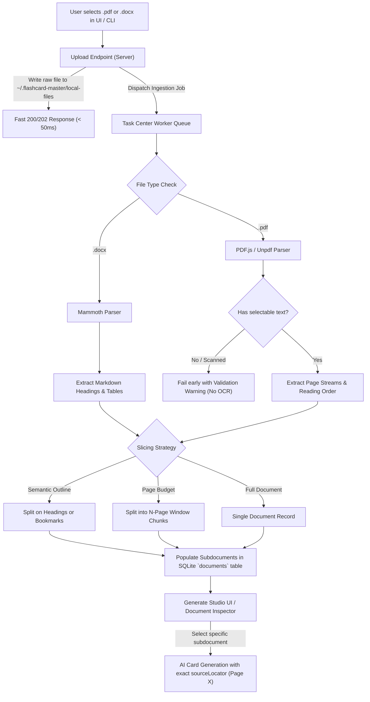
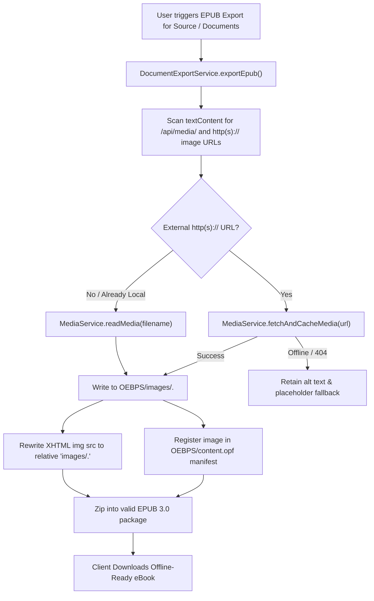
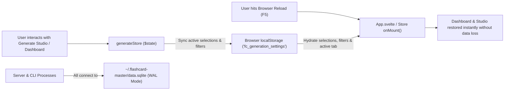

# Architecture Diagrams: Epic 17

## 1. Local PDF & Word Ingestion & Slicing Pipeline

## 2. Remote Media Localization in Document / EPUB Export

## 3. Persistent Client & Dashboard State Pipeline

