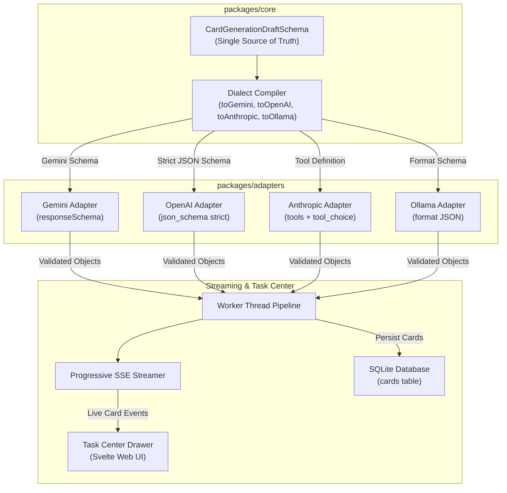

# Architecture Diagrams

This companion contains structural and sequential diagrams representing the provider-native structured response pipeline.

---

## 1. Structured Response Generation Pipeline



---

## 2. Token Limit Cutoff & Partial Retention Flow

```mermaid
sequenceDiagram
    autonumber
    participant UI as Task Center (Web UI)
    participant Worker as Generation Worker
    participant LLM as Provider API
    participant DB as SQLite DB

    UI->>Worker: Dispatch card generation job
    Worker->>LLM: Request structured generation (compiled schema)
    loop Progressive Card Stream
        LLM-->>Worker: Stream object / tool execution
        Worker->>Worker: Validate single card against Zod
        Worker->>DB: Commit card with keywords + sourceLocator
        Worker-->>UI: SSE event (card_created)
    end

    Note over LLM,Worker: Output Token Limit Reached (Max Tokens)
    LLM--xWorker: Stream terminates with finish_reason='length'
    Worker->>Worker: Confirm completed cards preserved
    Worker-->>UI: SSE event (job_warning: "Partial output saved; token limit reached")
    Worker->>DB: Update job status (COMPLETED_WITH_WARNINGS)
    UI->>UI: Render warning banner + preserve all generated cards
```
