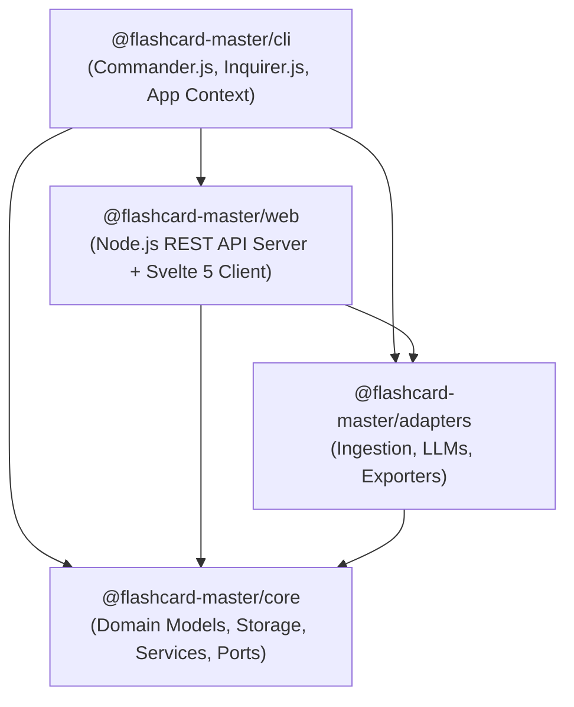
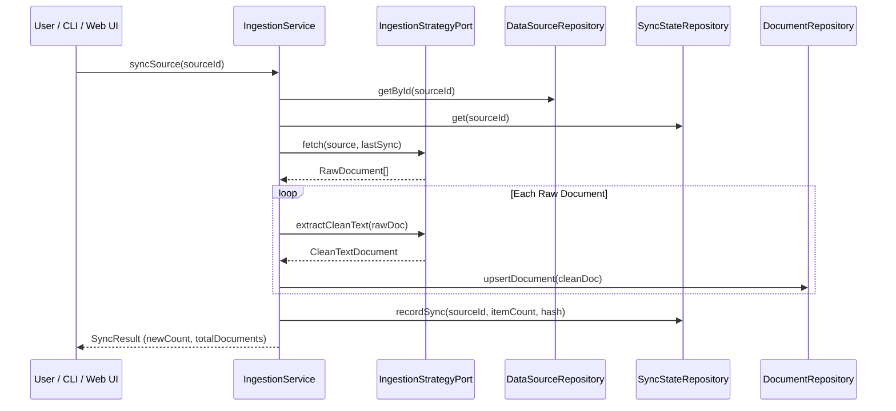
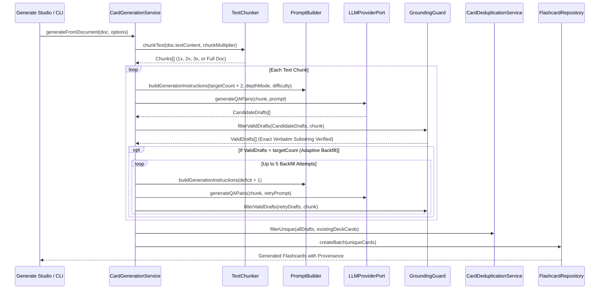

# 🏛️ Flashcard Master Architecture & System Design

**Document Version:** 1.0.0  
**Target Audience:** Core Contributors, System Architects & Extension Developers  

---

## 1. Architectural Philosophy & Invariants

Flashcard Master is built on five non-negotiable core invariants:

1. **Local-First & Zero Telemetry:** All data sources, extracted articles, vector hashes, settings, and flashcards reside strictly on the user's local disk in SQLite (`~/.flashcard-master/flashcards.db`). No telemetry or user content is ever sent to external cloud servers (except direct user-configured LLM API calls).
2. **Strict Factual Grounding (Zero Hallucinations):** Every flashcard MUST cite an exact, verbatim substring from the source document. Flashcards with altered, paraphrased, or hallucinated quotes are automatically rejected by `GroundingGuard`.
3. **Ports & Adapters (Hexagonal Architecture):** Domain logic and core services are isolated from infrastructure. Database engines, LLMs, ingestion protocols, and exporters are swappable ports.
4. **Adaptive Synthesis & Density Guarantee:** When card generation is requested, the system uses oversampling and bounded backfill loops to guarantee the exact target card quota is delivered even when ungrounded drafts are discarded.
5. **Minimal Information Principle:** Questions prioritize atomic active recall, structured cognitive calibration (Beginner, Intermediate, Expert), and customizable learning personas.

---

## 2. Monorepo Package Topology



### Package Responsibilities:

| Package | Role | Key Components |
| :--- | :--- | :--- |
| **`@flashcard-master/core`** | Domain Kernel & Data Access | `Flashcard`, `DataSource`, `CleanTextDocument`, `CardGenerationService`, `TextChunker`, `PromptBuilder`, `GroundingGuard`, `CardDeduplicationService`, `FlashcardRepository`, `DataSourceRepository`, `SyncStateRepository`, `DocumentRepository`, `createDatabaseClient`. |
| **`@flashcard-master/adapters`** | External Protocols & Vendor SDKs | `RssIngestionStrategy`, `WebReaderStrategy`, `LocalFileStrategy`, `EpubParser`, `SitemapIngestionStrategy`, `LlmsTxtIngestionStrategy`, `OllamaAdapter`, `OpenAIAdapter`, `GeminiAdapter`, `AnthropicAdapter`, `AnkiPackageExporter`, `AnkiConnectAdapter`, `MarkdownExporter`, `HtmlStudyGuideExporter`, `PdfStudyGuideExporter`, `CsvExporter`, `TsvExporter`. |
| **`@flashcard-master/cli`** | Headless CLI & Terminal Wizards | `createCli()`, `createAppContext()`, Interactive Setup Wizard, Commands (`init`, `source`, `sync`, `generate`, `export`, `cards`, `serve`). |
| **`@flashcard-master/web`** | Local SPA & REST Backend | `createWebServer()`, `server.ts` HTTP router, Svelte 5 single-page application (`DashboardView`, `SourcesView`, `GenerateStudio`, `QuestionExplorer`, `ExportCenter`). |

---

## 3. Detailed Subsystem Lifecycles

### 3.1 Ingestion & Document Pipeline



### 3.2 AI Card Generation & Verification Pipeline



---

## 4. SQLite Database Schema & Migration Invariants

The database client uses **`better-sqlite3`** with Write-Ahead Logging (`WAL`) mode enabled. Schema migrations in [`packages/core/src/storage/db.ts`](file:///C:/Users/aprodan/Workspace/Projects/flashcard-master/packages/core/src/storage/db.ts) run automatically on boot.

### Core Tables:

```sql
-- 1. Ingestion Sources (Knowledge-First, decoupled from flashcard decks)
CREATE TABLE data_sources (
    id TEXT PRIMARY KEY,
    name TEXT NOT NULL,
    type TEXT NOT NULL CHECK(type IN ('rss', 'web', 'local', 'sitemap', 'llms-txt', 'notion')),
    uri TEXT NOT NULL,
    tags TEXT NOT NULL DEFAULT '[]',
    is_active INTEGER NOT NULL DEFAULT 1,
    created_at TEXT NOT NULL DEFAULT (strftime('%Y-%m-%dT%H:%M:%SZ', 'now')),
    updated_at TEXT NOT NULL DEFAULT (strftime('%Y-%m-%dT%H:%M:%SZ', 'now'))
);

-- 2. Discovered Documents Catalog
CREATE TABLE documents (
    id TEXT PRIMARY KEY,
    source_id TEXT NOT NULL REFERENCES data_sources(id) ON DELETE CASCADE,
    title TEXT NOT NULL,
    url TEXT,
    text_content TEXT,
    content_hash TEXT,
    word_count INTEGER DEFAULT 0,
    created_at TEXT NOT NULL DEFAULT (strftime('%Y-%m-%dT%H:%M:%SZ', 'now')),
    updated_at TEXT NOT NULL DEFAULT (strftime('%Y-%m-%dT%H:%M:%SZ', 'now'))
);

-- 3. Sync State Metadata
CREATE TABLE sync_state (
    source_id TEXT PRIMARY KEY REFERENCES data_sources(id) ON DELETE CASCADE,
    last_synced_at TEXT NOT NULL,
    last_guid TEXT,
    content_hash TEXT,
    item_count INTEGER NOT NULL DEFAULT 0
);

-- 4. Flashcards Database (Deck routing designated at generation time)
CREATE TABLE flashcards (
    id TEXT PRIMARY KEY,
    source_id TEXT REFERENCES data_sources(id) ON DELETE SET NULL,
    question TEXT NOT NULL,
    answer TEXT NOT NULL,
    source_quote TEXT NOT NULL,
    source_origin_url TEXT,
    document_title TEXT,
    difficulty TEXT NOT NULL CHECK(difficulty IN ('beginner', 'intermediate', 'expert')),
    persona_used TEXT NOT NULL DEFAULT 'socratic-mentor',
    target_deck TEXT NOT NULL DEFAULT 'Default',
    tags TEXT NOT NULL DEFAULT '[]',
    created_at TEXT NOT NULL DEFAULT (strftime('%Y-%m-%dT%H:%M:%SZ', 'now')),
    updated_at TEXT NOT NULL DEFAULT (strftime('%Y-%m-%dT%H:%M:%SZ', 'now'))
);

-- 5. System Settings & Credentials Store
CREATE TABLE app_settings (
    key TEXT PRIMARY KEY,
    value TEXT NOT NULL,
    updated_at TEXT NOT NULL DEFAULT (strftime('%Y-%m-%dT%H:%M:%SZ', 'now'))
);
```

---

## 6. Centralized Settings & Configuration Precedence

Flashcard Master unifies application configurations through `SettingsService` in `@flashcard-master/core`. It follows a strict 3-tier precedence hierarchy:

```
SQLite app_settings  ──▶  process.env Fallback  ──▶  Hardcoded Default
```

* **Dynamic Resolvers:** Components such as `AnkiConnectAdapter` and `JobManager` accept dynamic settings resolvers, enabling instant runtime updates (e.g., changing AnkiConnect port or worker pool concurrency) without restarting the Node.js server.
* **Secret Protection:** API keys and sensitive tokens are masked when sent over REST endpoints and never output to console logs.
* **Origin Metadata:** Every configuration item tracks its effective origin (`database`, `env`, or `default`), exposed directly to the UI with visual source badges.
For a complete registry of configuration keys, see [Centralized Settings & Configuration Guide](settings-configuration.md).

---

## 5. Exporter Architecture

Flashcard Master uses an open **`ExporterRegistry`**. Exporters implement:

```typescript
export interface ExporterPort {
  readonly format: string;
  export(cards: Flashcard[], options?: ExportOptions): Promise<ExportResult>;
}
```

* **Anki Package Exporter (`apkg`):** Builds `.apkg` SQLite bundles using `sql.js` with front/back templates, CSS styling, and Anki schema tables (`col`, `notes`, `cards`).
* **AnkiConnect Exporter (`ankiconnect`):** Communicates with running Anki Desktop instances via HTTP (`http://127.0.0.1:8765`), creating decks and calling `addNotes`.
* **Markdown Exporter (`markdown`):** Formats cards into active-recall collapsible `<details><summary>` HTML blocks.
* **HTML / Printable PDF Exporter (`html` / `pdf`):** Produces a clean 2-column printable study guide with `@media print` CSS layout, folding cut lines, and browser "Save as PDF" optimization.
* **Delimited Exporters (`csv` / `tsv`):** Exports standard RFC-4180 Anki-compatible delimited text.
