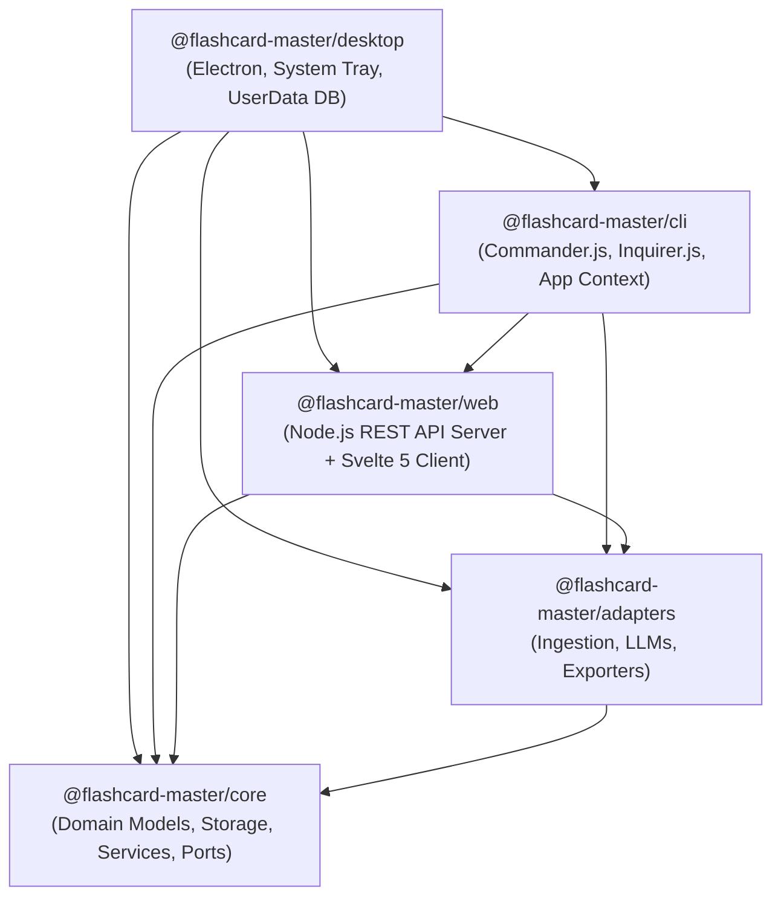
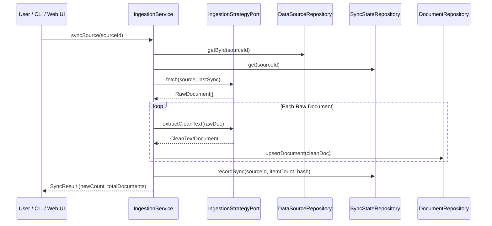
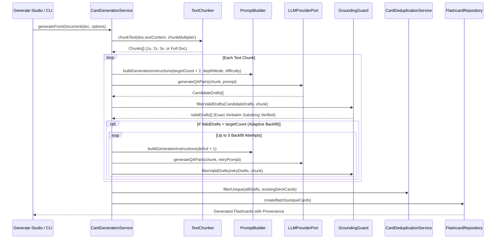

# 🏛️ Flashcard Master Architecture & System Design

**Document Version:** 1.0.0  
**Target Audience:** Core Contributors, System Architects & Extension Developers  

---

## 1. Architectural Philosophy & Invariants

Flashcard Master is built on five non-negotiable core invariants:

1. **Local-First & Zero Telemetry:** All data sources, extracted articles, vector hashes, settings, and flashcards reside strictly on the user's local disk in SQLite (`~/.flashcard-master/flashcards.db`). No telemetry or user content is ever sent to external cloud servers (except direct user-configured LLM API calls).
2. **Strict Factual Grounding (Zero Hallucinations):** Every flashcard MUST cite an exact, verbatim substring from the source document. Flashcards with altered, paraphrased, or hallucinated quotes are automatically rejected by `GroundingGuard`.
3. **Ports & Adapters (Hexagonal Architecture):** Domain logic and core services are isolated from infrastructure. Database engines, LLMs, ingestion protocols, and exporters are swappable ports.
4. **Adaptive Synthesis & Density Guarantee:** When card generation is requested, the system uses oversampling and bounded backfill loops to guarantee the exact target card quota is delivered even when ungrounded drafts are discarded.
5. **Minimal Information Principle:** Questions prioritize atomic active recall, structured cognitive calibration (Beginner, Intermediate, Expert), and customizable learning personas.

---

## 2. Monorepo Package Topology



### Package Responsibilities:

| Package | Role | Key Components |
| :--- | :--- | :--- |
| **`@flashcard-master/core`** | Domain Kernel & Data Access | `Flashcard`, `DataSource`, `CleanTextDocument`, `CardGenerationService`, `TextChunker`, `PromptBuilder`, `GroundingGuard`, `CardDeduplicationService`, `FlashcardRepository`, `DataSourceRepository`, `SyncStateRepository`, `DocumentRepository`, `createDatabaseClient`. |
| **`@flashcard-master/adapters`** | External Protocols & Vendor SDKs | `RssIngestionStrategy`, `WebReaderStrategy`, `LocalFileStrategy`, `EpubParser`, `SitemapIngestionStrategy`, `LlmsTxtIngestionStrategy`, `OllamaAdapter`, `OpenAIAdapter`, `GeminiAdapter`, `AnthropicAdapter`, `AnkiPackageExporter`, `AnkiConnectAdapter`, `MarkdownExporter`, `HtmlStudyGuideExporter`, `PdfStudyGuideExporter`, `CsvExporter`, `TsvExporter`. |
| **`@flashcard-master/cli`** | Headless CLI & Terminal Wizards | `createCli()`, `createAppContext()`, Interactive Setup Wizard, Commands (`init`, `source`, `sync`, `generate`, `export`, `cards`, `serve`). |
| **`@flashcard-master/web`** | Local SPA & REST Backend | `createWebServer()`, `server.ts` HTTP router, Svelte 5 single-page application (`DashboardView`, `SourcesView`, `GenerateStudio`, `QuestionExplorer`, `ExportCenter`). |
| **`@flashcard-master/desktop`** | Standalone Cross-Platform Desktop App | `bootstrapDesktopServer()`, Electron main process (`main.ts`), custom dark slate window framing, system tray minimize/restore, OS `userData` SQLite storage isolation, and multi-OS `electron-builder` packaging (`.exe`, `.dmg`, `.AppImage`, `.deb`). |

---

## 3. Detailed Subsystem Lifecycles

### 3.1 Ingestion & Document Pipeline



### 3.2 AI Card Generation & Verification Pipeline



---

## 4. SQLite Database Schema & Migration Invariants

The database client uses **`better-sqlite3`** with Write-Ahead Logging (`WAL`) mode enabled. Schema migrations in [`packages/core/src/storage/db.ts`](file:///C:/Users/aprodan/Workspace/Projects/flashcard-master/packages/core/src/storage/db.ts) run automatically on boot.

### Core Tables:

```sql
-- 1. Ingestion Sources (Knowledge-First, decoupled from flashcard decks)
CREATE TABLE data_sources (
    id TEXT PRIMARY KEY,
    name TEXT NOT NULL,
    type TEXT NOT NULL CHECK(type IN ('rss', 'web', 'local', 'sitemap', 'llms-txt', 'notion')),
    uri TEXT NOT NULL,
    tags TEXT NOT NULL DEFAULT '[]',
    is_active INTEGER NOT NULL DEFAULT 1,
    created_at TEXT NOT NULL DEFAULT (strftime('%Y-%m-%dT%H:%M:%SZ', 'now')),
    updated_at TEXT NOT NULL DEFAULT (strftime('%Y-%m-%dT%H:%M:%SZ', 'now'))
);

-- 2. Discovered Documents Catalog
CREATE TABLE documents (
    id TEXT PRIMARY KEY,
    source_id TEXT NOT NULL REFERENCES data_sources(id) ON DELETE CASCADE,
    title TEXT NOT NULL,
    url TEXT,
    text_content TEXT,
    content_hash TEXT,
    word_count INTEGER DEFAULT 0,
    created_at TEXT NOT NULL DEFAULT (strftime('%Y-%m-%dT%H:%M:%SZ', 'now')),
    updated_at TEXT NOT NULL DEFAULT (strftime('%Y-%m-%dT%H:%M:%SZ', 'now'))
);

-- 3. Sync State Metadata
CREATE TABLE sync_state (
    source_id TEXT PRIMARY KEY REFERENCES data_sources(id) ON DELETE CASCADE,
    last_synced_at TEXT NOT NULL,
    last_guid TEXT,
    content_hash TEXT,
    item_count INTEGER NOT NULL DEFAULT 0
);

-- 4. Flashcards Database (Deck routing designated at generation time)
CREATE TABLE flashcards (
    id TEXT PRIMARY KEY,
    source_id TEXT REFERENCES data_sources(id) ON DELETE SET NULL,
    question TEXT NOT NULL,
    answer TEXT NOT NULL,
    source_quote TEXT NOT NULL,
    source_origin_url TEXT,
    document_title TEXT,
    keywords TEXT NOT NULL DEFAULT '[]',
    source_locator TEXT NOT NULL DEFAULT '',
    difficulty TEXT NOT NULL CHECK(difficulty IN ('beginner', 'intermediate', 'expert', 'mixed')),
    persona_used TEXT NOT NULL DEFAULT 'socratic-mentor',
    target_deck TEXT NOT NULL DEFAULT 'Default',
    tags TEXT NOT NULL DEFAULT '[]',
    created_at TEXT NOT NULL DEFAULT (strftime('%Y-%m-%dT%H:%M:%SZ', 'now')),
    updated_at TEXT NOT NULL DEFAULT (strftime('%Y-%m-%dT%H:%M:%SZ', 'now'))
);

CREATE INDEX idx_flashcards_created_at_id ON flashcards(created_at DESC, id DESC);
CREATE INDEX idx_flashcards_target_deck ON flashcards(target_deck);
CREATE INDEX idx_flashcards_difficulty ON flashcards(difficulty);

-- 5. System Settings & Credentials Store
CREATE TABLE app_settings (
    key TEXT PRIMARY KEY,
    value TEXT NOT NULL,
    updated_at TEXT NOT NULL DEFAULT (strftime('%Y-%m-%dT%H:%M:%SZ', 'now'))
);
```

---

## 5. Keyset / Cursor Pagination & Infinite Scrolling

Flashcard Master implements high-performance **keyset / cursor-based pagination** for browsing large flashcard collections in the Question Explorer:

```
Client (IntersectionObserver)  ──▶  GET /api/cards?limit=25&cursor=<base64>  ──▶  SQLite Keyset Seek
```

* **Keyset Query**: Paginated queries seek directly on the composite index `(created_at DESC, id DESC)`:
  ```sql
  WHERE ((created_at < :cursorCreatedAt) OR (created_at = :cursorCreatedAt AND id < :cursorId))
  ORDER BY created_at DESC, id DESC
  LIMIT :limit + 1;
  ```
* **Opaque Cursor**: The cursor is a compact, URL-safe base64 token encoding `{ c: createdAt, i: id }`.
* **Zero Offset Degradation**: Cursor pagination performs an $O(1)$ index seek regardless of page depth and is completely immune to page drift or duplicate items caused by concurrent card creation or deletion.
* **Backward Compatibility**: `GET /api/cards` continues to return flat `Flashcard[]` arrays when pagination parameters are omitted, and supports `offset` queries as a legacy fallback.

---

## 6. Centralized Settings & Configuration Precedence

Flashcard Master unifies application configurations through `SettingsService` in `@flashcard-master/core`. It follows a strict 3-tier precedence hierarchy:

```
SQLite app_settings  ──▶  process.env Fallback  ──▶  Hardcoded Default
```

* **Dynamic Resolvers:** Components such as `AnkiConnectAdapter` and `JobManager` accept dynamic settings resolvers, enabling instant runtime updates (e.g., changing AnkiConnect port or worker pool concurrency) without restarting the Node.js server.
* **Secret Protection:** API keys and sensitive tokens are masked when sent over REST endpoints and never output to console logs.
* **Origin Metadata:** Every configuration item tracks its effective origin (`database`, `env`, or `default`), exposed directly to the UI with visual source badges.
For a complete registry of configuration keys, see [Centralized Settings & Configuration Guide](settings-configuration.md).

---

## 7. Deck Operations & Lifecycle Management

To support flexible study workflows and prevent deck sprawl, Flashcard Master provides atomic, transactional deck manipulation utilities implemented in `FlashcardRepository`:

```
Question Explorer UI  ──▶  REST Endpoints  ──▶  FlashcardRepository (SQLite WAL Transaction)
```

* **Deck Cloning (`cloneDeck`)**:
  - `POST /api/decks/clone` (`{ sourceDeck, targetDeck }`)
  - Duplicates all cards from a source deck into a new target deck with fresh UUIDs.
  - Preserves verbatim source quotes, difficulty ratings, tags, keywords, and document origin metadata.
  - Executes inside an atomic SQLite transaction (`this.db.transaction()`), ensuring all-or-nothing execution.
* **Batch Splitting (`splitDeck`)**:
  - `POST /api/decks/split` (`{ sourceDeck, batchSize, customPrefix? }`)
  - Automatically partitions a large deck into numbered bite-sized sub-decks (e.g., `${prefix} - Part 1`, `${prefix} - Part 2`).
  - Ideal for pacing study sessions across multiple days or modules.
* **Selective Card Moving (`moveCards`)**:
  - `POST /api/decks/move-cards` (`{ cardIds, targetDeck }`)
  - Selectively relocates a chosen subset of flashcards from Question Explorer into an existing or newly created deck.
  - Updates `target_deck` and refreshes `updated_at` timestamps transactionally.

---

## 8. Exporter Architecture

Flashcard Master uses an open **`ExporterRegistry`**. Exporters implement:

```typescript
export interface ExporterPort {
  readonly format: string;
  export(cards: Flashcard[], options?: ExportOptions): Promise<ExportResult>;
}
```

* **Anki Package Exporter (`apkg`):** Builds `.apkg` SQLite bundles using `sql.js` with front/back templates, CSS styling, and Anki schema tables (`col`, `notes`, `cards`).
* **AnkiConnect Exporter (`ankiconnect`):** Communicates with running Anki Desktop instances via HTTP (`http://127.0.0.1:8765`), creating decks and calling `addNotes`.
* **Markdown Exporter (`markdown`):** Formats cards into active-recall collapsible `<details><summary>` HTML blocks.
* **HTML / Printable PDF Exporter (`html` / `pdf`):** Produces a clean 2-column printable study guide with `@media print` CSS layout, folding cut lines, and browser "Save as PDF" optimization.
* **Delimited Exporters (`csv` / `tsv`):** Exports standard RFC-4180 Anki-compatible delimited text.

### Partial, Date-Filtered & Randomized Export Engine

Flashcard Master supports granular scoping and stochastic subsampling across all export formats, the AnkiConnect live sync integration, the headless CLI, and the web interface:

1. **Card Filtering Criteria (`CardFilter`):**
   - `createdAfter` / `createdBefore`: ISO 8601 timestamp comparisons (`YYYY-MM-DDTHH:mm:ssZ` or `YYYY-MM-DD` auto-expanded to start/end of day UTC) evaluated directly against `flashcards.created_at`.
   - `limit`: Numerical upper bound capping the exported card count.
   - `shuffle`: Enables SQLite `ORDER BY RANDOM()` for true uniform stochastic subsampling when paired with `limit`.
2. **Exporter Format Independence:**
   - Because `ExportService` delegates card fetching directly to `cardRepo.list(filter)` prior to format rendering, all exporters (`apkg`, `epub`, `markdown`, `html`, `pdf`, `csv`, `tsv`) inherit date range filtering, card budget limits, and random shuffling with zero format-specific changes.
3. **REST Endpoints:**
   - `GET /api/export` & `GET /api/export/:format`: Accepts query parameters `deck`, `tag`, `after` / `createdAfter`, `before` / `createdBefore`, `limit`, and `shuffle=true`. Returns HTTP 404 with a structured error message if filter criteria match 0 cards.
   - `POST /api/ankiconnect/sync`: Accepts JSON body `{ targetDeck?, tag?, createdAfter?, createdBefore?, limit?, shuffle? }` to push scoped and randomized subsets directly to Anki Desktop.
4. **Headless CLI:**
   - `flashcard-master export <format> [--deck <name>] [--after <date>] [--before <date>] [--limit <number>] [--shuffle] [--output <path>]`
5. **Interactive UI (`ExportCenter.svelte`):**
   - "Time & Scope Filter" accordion card with one-click date range presets (*All Time*, *Last 24 Hours*, *Last 7 Days*, *Last 30 Days*, *Custom Range*), custom date pickers, card limit budget input, uniform shuffle toggle, and reactive matching cards counter.

---

## 9. Data Source Management & Tag Organization

Flashcard Master organizes knowledge sources with an interactive, normalized tag taxonomy across both data source creation and editing workflows:

```
Client (TagInput.svelte)  ──▶  GET /api/sources/tags  ──▶  DataSourceRepository.listAllTags() (SQLite)
```

* **Tag Normalization Invariants:**
  - All tags are trimmed, lowercased, and stripped of leading hash (`#`) symbols upon ingestion and entry.
  - Tags within a data source are automatically deduplicated into a set.
  - Stored as a clean JSON string array in `data_sources.tags`.
* **Distinct Tag Discovery (`listAllTags`):**
  - `GET /api/sources/tags` returns a sorted array of all unique, lowercased tags currently used across active and inactive sources.
  - Enables instant auto-suggest dropdowns in the user interface as users type.
* **Interactive Tag Input (`TagInput.svelte`):**
  - Reusable pill-based input component supporting full keyboard navigation:
    - `Enter` or `,` (comma): commits the current text as a new tag pill.
    - `Backspace` on empty input: removes the preceding tag pill.
    - `ArrowUp` / `ArrowDown`: highlights auto-suggestions from the filtered list.
    - `Escape`: dismisses the suggestion dropdown.
    - Pill removal button (`✕`): immediately deletes individual tags.

---

## 10. Asynchronous Subdocument Generation via Task Center

Flashcard Master unifies targeted card generation across individual subdocuments, chapters, and sliced sections into the asynchronous background worker queue:

```
Inspector UI  ──▶  POST /api/generate (async)  ──▶  JobManager (Worker Queue)  ──▶  Task Center (SSE Live Stream)
```

* **Non-Blocking User Experience:**
  - Generating cards for an individual document from `SourceDocumentInspector.svelte` immediately enqueues a background task (`HTTP 202 Accepted`).
  - The in-context configuration modal closes instantly, returning control to the user.
  - The Task Center drawer opens to the **Active Tasks** tab, expanding the new task so users can observe step progress, token counts, and streamed cards in real time.
* **Document Metadata & Provenance:**
  - Single-document generation jobs track `documentIds`, `sourceIds`, and `documentTitle` directly within job metadata.
  - Job titles dynamically reflect target document names (e.g., `Synthesize flashcards: "Chapter 1: Overview"`).
* **Reactive Completion & Badge Refresh:**
  - Client components subscribe to task completion events through `taskStore.onJobCompleted(listener)`.
  - When a generation task finishes in the background worker pool, `SourceDocumentInspector` detects that documents in the current source were updated and automatically refreshes card counts without requiring a manual browser refresh.

---

## 11. Responsive Layout & Text Overflow Hardening Standards

To ensure a seamless user experience across diverse desktop displays, laptops, and mobile screens, Flashcard Master adheres to strict responsive layout and text overflow invariants across all user interfaces:

```
Fluid Viewports (320px ─▶ 4K)  ──▶  Auto-Clamped Grids & Drawers  ──▶  Independent Scroll Containers
```

* **Dynamic Grid Columns:**
  - Card grids (e.g., `QuestionExplorer.svelte`) utilize `repeat(auto-fill, minmax(min(100%, 360px), 1fr))` rather than fixed minimum pixel widths. On screens narrower than 360px, cards scale fluidly down to 100% of the viewport width without causing horizontal spill or clipping.
* **Unbroken Token & Word-Break Safety:**
  - Technical strings such as long URLs, composite IDs, and source locators enforce `min-width: 0`, `overflow-wrap: break-word`, and `word-break: break-word`. Flex and grid child items are given explicit `min-width: 0` constraints so the browser allows elements to shrink below their internal content size.
* **Collapsible Quote Grounding:**
  - In `QuestionExplorer.svelte`, verbatim source quotes exceeding 180 characters are clamped to 3 lines (`-webkit-line-clamp: 3`) with a dedicated "▼ Show more" / "▲ Show less" button. This keeps card geometry consistent while ensuring complete citations remain fully accessible on demand.
* **Preformatted Text & Table Containers:**
  - In markdown reader views and raw content inspectors (e.g., `DocumentPreviewModal.svelte`), all `<pre>`, `<code>`, and `<table>` blocks enforce `max-width: 100%`, `box-sizing: border-box`, and independent horizontal scrollbars (`overflow-x: auto`). Tables and code snippets scroll cleanly within their respective viewports rather than pushing modals beyond screen boundaries.
* **Viewport-Clamped Modals & Drawers:**
  - Slide-over drawers (`CardEditorDrawer`, `TaskCenterDrawer`, `SourceDocumentInspector`) enforce fluid width clamps (`max-width: min(520px - 680px, 100vw)`), `box-sizing: border-box`, and responsive mobile padding via `@media (max-width: 640px)`.
  - Document and modal dialogs constrain outer dimensions to `max-width: min(860px, 95vw)` with responsive margin and padding adjustments on mobile viewports.
* **Document Trays & Deep Path Resiliency:**
  - In `GenerateStudio.svelte`, document items in source tree trays use flex-shrink limits, `min-width: 0` on title and info containers, and viewport-aware URL truncations (`max-width: min(220px, 35vw)`) with full URL tooltips on hover.

---

## 12. Generate Studio Target Scope Redesign & Modal Document Picker

Flashcard Master replaces nested accordion dropdowns in Generate Studio (`GenerateStudio.svelte`) with prominent **Source Scope Cards** and a dedicated **Document Picker Modal** (`SourceDocumentPickerModal.svelte`):

```
Target Scope (Studio)  ──▶  Source Scope Cards  ──▶  [Select Documents...]  ──▶  SourceDocumentPickerModal
      │                             │                                                 │
      ▼                             ▼                                                 ▼
Select All / Clear             Status Pills                                    Search & Filter Mode
(Global Selection)        (All, Partial, or None)                            (Apply to generateStore)
```

* **Source Scope Cards (`GenerateStudio.svelte`):**
  - Replaces nested accordion trees and scroll-trapped lists with clear, scannable cards representing each active data source.
  - Displays source type badge (`EPUB`, `PDF`, `Web Article`, etc.), source title, and search match badges.
  - Dynamically computes and displays status pills:
    - `✅ All N docs selected (~X words)`
    - `🎯 M of N docs selected (~X words)`
    - `⚪ 0 of N docs selected`
  - Inline quick actions: checkbox toggle for whole source, `Select All`, and `Clear`.
  - Prominent `📑 Select Documents...` button triggers focused modal document curation.
* **Focused Document Selector Modal (`SourceDocumentPickerModal.svelte`):**
  - Dedicated full-featured modal dialog allowing users to curate documents from large catalogs (e.g. 50+ EPUB chapters or sliced PDF documents) without cluttering or stretching the generation studio form.
  - Multi-token search bar with normalization, singular/plural tolerance, and stop-word filtering.
  - Filter mode tabs: `All`, `Selected`, and `Unselected`.
  - Bulk helpers: `Select All Visible`, `Clear Visible`, `Select All in Source`, and `Clear All`.
  - Scannable document rows with checkboxes, page coordinate badges, word count estimates, and card generation history.
  - Sticky footer with live selection counters and atomic `Apply Selection` button that syncs directly with `generateStore.selectedDocIds` and `generateStore.selectedSourceIds`.
* **Responsive Fluid Design:**
  - Adapts to mobile devices (`@media (max-width: 640px)`) with stacked controls, full viewport bounds (`100vw` / `100vh`), and touch-friendly targets.

---

## 13. Deck Operations, Partial Slicing & Selective Export Engine

Flashcard Master provides advanced deck lifecycle and granular scoping operations:

```
Question Explorer  ──▶  Clone Deck  ──▶  Atomic Duplicate with (Copy) Suffix
                   ──▶  Split Deck  ──▶  Even Partitioning across N Target Decks
                   ──▶  Move Cards  ──▶  Reassign Card Deck IDs with Filter Persistence
```

* **Deck Lifecycle Management (`QuestionExplorer.svelte`):**
  - **Clone Deck**: Atomically duplicates deck metadata and cards in SQLite, creating an independent fork with an auto-incremented `(Copy)` suffix.
  - **Split Deck**: Partitions a large deck (e.g. 100 cards) into $N$ smaller focused sub-decks of approximately equal size, preserving all citation links and difficulty tags.
  - **Selective Card Moving**: Moves selected card subsets between existing decks or creates a destination deck on the fly.
* **Scoping Filters in Export Engine (`ExportService.ts`):**
  - Supports targeted partial exports using creation date windows (`createdAfter`, `createdBefore`), limits (`limit`), and optional randomization (`shuffle`).
  - Ensures study guides, printable sheets, and Anki packages can be generated for recent study intervals (e.g., "cards generated this week") without exporting entire historical libraries.

---

## 14. Open-Source Foundations, In-Repo Skills & Documentation Hub

```
┌────────────────────────────────────────────────────────────────────────┐
│ Flashcard Master Open-Source System Architecture                       │
│                                                                        │
│  [AGPL-3.0 License]  ──▶  100% Free Local Use + SaaS Reciprocity       │
│  [Model Advisor]     ──▶  Contextual Model Recommendation Decision Tree│
│  [Docs Hub]          ──▶  VitePress + Automated GitHub Pages CI/CD     │
└────────────────────────────────────────────────────────────────────────┘
```

* **Legal Invariants & Copyleft Reciprocity (AGPL-3.0):**
  - The entire monorepo is governed by the GNU Affero General Public License v3.0 (`LICENSE`).
  - Guarantees 100% free use for local desktop users, researchers, and self-hosters while legally mandating that any network-accessible software modification (Section 13) must make its source code public.
* **In-Repo Agent Skills (`.agent/skills/`):**
  - Shipped skills (e.g., `model-advisor`) provide executable decision trees for evaluating token pricing, context lengths, and local offline privacy vs. high-throughput cloud synthesis.
* **Public Documentation Hub & GitHub Pages CI/CD:**
  - Authored with VitePress under `docs/`, featuring client-side search, mobile responsiveness, and dark-mode styling aligned with the Web UI.
  - Automatically compiled and deployed on pushes to `main` via `.github/workflows/deploy-docs.yml`.

---

## 15. Standalone Desktop Architecture (Electron & Multi-OS Distribution)

```
┌────────────────────────────────────────────────────────────────────────┐
│ @flashcard-master/desktop Composition Architecture                     │
│                                                                        │
│  [Electron Main]  ──▶  app.getPath('userData') Storage Isolation       │
│                   ──▶  bootstrapDesktopServer() -> In-Process Node API │
│                   ──▶  Ephemeral Loopback Port (127.0.0.1:0)           │
│                   ──▶  BrowserWindow (Dark Slate #0f172a)              │
│                   ──▶  System Tray Minimize/Restore Controls           │
└────────────────────────────────────────────────────────────────────────┘
```

* **Zero Backend Rewrites:**
  - Rather than re-architecting the web server into Electron IPC channels, `@flashcard-master/desktop` directly bootstraps `@flashcard-master/web` and `@flashcard-master/cli`'s application context in-process.
  - All existing REST API endpoints, Server-Sent Events (SSE) streaming task updates, and Svelte 5 UI views operate identically in desktop mode.
* **Storage Isolation & Dynamic Port Binding:**
  - SQLite database (`data.sqlite`) and media cache (`media/`) are placed in the OS-native user data path (`app.getPath('userData')`) — e.g., `%APPDATA%\Flashcard Master` on Windows, `~/Library/Application Support/Flashcard Master` on macOS, and `~/.config/Flashcard Master` on Linux.
  - The server binds dynamically to port `0` (an available ephemeral loopback port) to prevent collisions with any existing CLI servers running on port `3000`.
* **Security & Native UX:**
  - Enforces safe Electron defaults: `contextIsolation: true`, `sandbox: true`, and `nodeIntegration: false`.
  - Implements single-instance application locking (`app.requestSingleInstanceLock()`) to prevent multiple desktop instances from conflicting over WAL database locks.
  - Provides custom dark slate window background (`#0f172a`), taskbar/dock icon integration, and system tray background minimize/restore.
* **Multi-OS Release CI/CD Pipeline:**
  - Configured with `electron-builder` to produce standalone installers across all major operating systems: Windows (`.exe` NSIS installer + portable), macOS (`.dmg` Universal/arm64), and Linux (`.AppImage` + `.deb`).
  - Automated by `.github/workflows/release-desktop.yml`, which triggers on tag push (`v*`) to build and attach signed release binaries to GitHub Releases.


