# BMAD Framework Guide — flashcard-master

Welcome to the **BMAD (Breakthrough Method for Agile AI-Driven Development)** guide for the `flashcard-master` project.

BMAD is an AI-native development method and agentic framework that orchestrates specialized AI personas, structured workflows, and verified artifacts across the complete software development lifecycle.

---

## 1. Overview & Architecture

BMAD structures project delivery into a clear, repeatable agile lifecycle managed by specialized AI agent personas. Rather than unstructured prompts, BMAD relies on structured skill invocations, artifact-driven state transitions, and test-first implementation.

```mermaid
flowchart LR
    subgraph Discovery ["1. Discovery & Strategy"]
        A[bmad-brainstorming / forge-idea] --> B[bmad-deep-recon]
        B --> C[bmad-product-brief]
    end

    subgraph Planning ["2. Product & System Design"]
        C --> D[bmad-prd]
        D --> E[bmad-ux]
        D --> F[bmad-architecture]
        E & F --> G[bmad-create-epics-and-stories]
        G --> H[bmad-sprint-planning]
    end

    subgraph Execution ["3. Implementation & QA"]
        H --> I[bmad-build / bmad-build-auto]
        I --> J[bmad-review / bmad-code-review]
        J --> K[bmad-qa-generate-e2e-tests]
        K --> L[bmad-checkpoint-preview]
    end

    subgraph Evaluation ["4. Retrospective & Iteration"]
        L --> M[bmad-retrospective]
        M -->|Next Cycle| H
    end
```



---

## 2. Agent Personas

BMAD provides dedicated personas with specialized domain expertise and distinct perspectives:

| Persona | Role / Skill | Focus & Responsibilities |
| :--- | :--- | :--- |
| **Mary** | **Business Analyst**<br>`bmad-agent-analyst` | Strategic analysis, stakeholder voice, market & competitor research, problem decomposition using Porter's and Minto's frameworks. |
| **John** | **Product Manager**<br>`bmad-agent-pm` | Jobs-to-be-Done (JTBD), problem-solution fit, PRD creation, product validation, prioritization. |
| **Sally** | **UX Designer**<br>`bmad-agent-ux-designer` | User journeys, wireframing, interaction models, responsive UI design, accessible workflows. |
| **Winston** | **System Architect**<br>`bmad-agent-architect` | Architectural invariants, tech stack choices, data structures, API contracts, ADRs, scalability. |
| **Amelia** | **Senior Software Engineer**<br>`bmad-agent-dev` | Test-driven development (TDD: Red $\rightarrow$ Green $\rightarrow$ Refactor), clean code implementation, automated testing. |

> [!TIP]
> You can converse with individual personas directly (e.g., *"Ask Winston about database schema options"*) or convene a group session using `bmad-party-mode`.

---

## 3. Project Directory Structure

When BMAD is installed, the project directory includes the following structure:

```text
flashcard-master/
├── .agent/skills/                  # Antigravity agent skill definitions
├── .agents/skills/                 # Antigravity-CLI and Cursor skill definitions
├── .claude/skills/                 # Claude Code skill definitions
├── _bmad/                          # BMAD core engine, templates, and scripts
│   ├── config.toml                 # Project configuration (managed)
│   ├── config.user.toml            # Personal local overrides
│   ├── bmm/                        # BMAD Method Module workflows and rules
│   ├── core/                       # Core engine schemas and manifests
│   └── custom/                     # Custom module and agent extensions
├── _bmad-output/                   # Generated artifacts directory
│   ├── planning-artifacts/         # Briefs, PRDs, UX designs, Architecture, Epics
│   └── implementation-artifacts/   # Sprint status, story tracking, code reviews
├── docs/                           # Long-term project documentation and knowledge
└── src/                            # Application source code
```

---

## 4. End-to-End Workflow Guide

### Step 1: Ideation & Research
1. **Brainstorming / Idea Validation**:
   - Run `bmad-brainstorming` or `bmad-forge-idea` to explore concepts, user pain points, and edge cases.
   - Run `bmad-prfaq` to stress-test your concept from a customer-first perspective.
2. **Deep Reconnaissance**:
   - Run `bmad-deep-recon` (or request market, domain, or technical research) to gather competitive and technical intelligence.
3. **Product Brief**:
   - Run `bmad-product-brief` to produce a concise, actionable product brief.

### Step 2: Planning & Architecture
1. **Product Requirements Document (PRD)**:
   - Run `bmad-prd` to author or validate the PRD (`_bmad-output/planning-artifacts/prd.md`).
2. **User Experience Specification**:
   - Run `bmad-ux` to plan UI patterns, screen layouts, design tokens, and user interactions.
3. **System Architecture**:
   - Run `bmad-architecture` to establish technical architecture, component boundaries, invariants, and tech stack choices.
4. **Epics & User Stories**:
   - Run `bmad-create-epics-and-stories` or `bmad-spec` to break requirements into prioritized epics with verifiable Acceptance Criteria (AC).
5. **Sprint Planning**:
   - Run `bmad-sprint-planning` to initialize sprint tracking (`_bmad-output/implementation-artifacts/sprint-status.yaml`).

### Step 3: Implementation & Development
1. **Story Execution**:
   - Run `bmad-build` to implement user stories following test-first principles.
   - Run `bmad-build-auto` for automated continuous story completion.
2. **Code & Quality Review**:
   - Run `bmad-review` or `bmad-code-review` to perform adversarial, edge-case, and verification gap reviews across diffs.
   - Run `bmad-qa-generate-e2e-tests` to generate automated end-to-end tests for implemented features.
3. **Human-in-the-Loop Verification**:
   - Run `bmad-checkpoint-preview` to walk through code changes, test results, and verification steps.

### Step 4: Sprint Tracking & Retrospective
1. **Handling Mid-Sprint Changes**:
   - If requirements or technical constraints change mid-sprint, run `bmad-correct-course`.
2. **Epic Retrospective**:
   - Upon completing an epic, run `bmad-retrospective` to audit deliverables against initial requirements and capture learnings.

---

## 5. Quick Command Reference

| Intent | Recommended Skill | Prompt Example |
| :--- | :--- | :--- |
| **Get Help / Guidance** | `bmad-help` | *"What should I do next in BMAD?"* |
| **Brainstorm** | `bmad-brainstorming` | *"Help me brainstorm flashcard study modes"* |
| **Product Brief** | `bmad-product-brief` | *"Create a product brief for flashcard-master"* |
| **Create PRD** | `bmad-prd` | *"Create the PRD"* |
| **Design UX** | `bmad-ux` | *"Create UX specifications for card review session"* |
| **Architecture** | `bmad-architecture` | *"Create technical architecture"* |
| **Breakdown Stories** | `bmad-create-epics-and-stories` | *"Create epics and stories list"* |
| **Sprint Plan** | `bmad-sprint-planning` | *"Run sprint planning"* |
| **Implement Story** | `bmad-build` | *"Build story US-001"* |
| **Code Review** | `bmad-code-review` | *"Review this code"* |
| **Generate Tests** | `bmad-qa-generate-e2e-tests` | *"Create QA automated tests for deck creation"* |
| **Group Roundtable** | `bmad-party-mode` | *"Start party mode to discuss state management"* |

---

## 6. Environment & Maintenance

### Prerequisites
- **Node.js**: `v20.12.0+` or `v22.x LTS`
- **uv**: Astral Python package manager (installed at `~/.local/bin/uv`) for Python-backed skills (`bmad-build`, `bmad-build-auto`)

### CLI Maintenance Commands
- Check installation status:
  ```bash
  npx bmad-method status
  ```
- Update BMAD modules:
  ```bash
  npx bmad-method install --action update --yes
  ```
- Reconfigure tools or settings:
  ```bash
  npx bmad-method install --list-options
  ```
